# Report

Results of the benchmark described in [README.md](README.md): two released learned components,
Disco103 (a meta-learned update rule) and OPEN (a learned optimizer), against REINFORCE, A2C and PPO
on nine JAX environments from gymnax. This file is generated by `report.py` from the run data. It
states what was measured.

## Protocol

Each method has one searched setting: the learning rate, or for OPEN which released weights to use.
Every value is run with seeds 0, 1 and 2; if the best learning rate is the lowest or highest one
tried, the next value in that direction is run too, at most twice. The best value is then run with
ten new seeds, 10 to 19. All numbers under *Evaluation* come from those ten runs. Every method uses
16 environments and is given the same number of environment steps.

How to read the tables:

- **Final return** is the mean return of the last 100 episodes of a run. Tables give the mean over
  seeds, the lowest and highest seed, and every seed.
- **Trailing mean** is the mean return of the last 100 episodes up to a given point in training.
- With ten seeds, methods whose ranges overlap should not be ranked against each other.
- The data behind every table and figure is in `results/<environment>/runs.csv` and `curves.csv`.
  `results/dashboard.html` shows the learning curves as interactive charts.

## Summary

Final return in the evaluation runs: mean over seeds (lowest..highest seed).

| Method | Catch | CartPole-v1 | Acrobot-v1 | FourRooms | DeepSea | MinAtar Breakout | MinAtar Space Invaders | MinAtar Asterix | MinAtar Freeway |
|---|---|---|---|---|---|---|---|---|---|
| REINFORCE | 1.00 (1.00..1.00) | 434 (217..500) | −254 (−500..−84) | 0.97 (0.92..0.99) | 0.99 (0.99..0.99) | 6.0 (0.0..13.3) | 19.1 (9.0..23.6) | 0.9 (0.7..1.0) | 24.1 (22.4..25.8) |
| A2C | 0.99 (0.98..1.00) | 461 (360..500) | −85 (−92..−82) | 1.00 (0.99..1.00) | 0.99 (0.99..0.99) | 6.2 (5.3..9.0) | 42.1 (27.6..74.6) | 1.4 (0.9..1.7) | 33.4 (31.6..36.3) |
| PPO | 1.00 (0.98..1.00) | 481 (437..500) | −81 (−84..−79) | 1.00 (1.00..1.00) | 0.79 (0.00..0.99) | 13.4 (6.3..19.7) | 59.5 (50.4..68.7) | 1.9 (1.2..2.9) | 31.2 (28.8..33.2) |
| PPO + Adam, OPEN's loop | 1.00 (0.98..1.00) | 455 (160..495) | −82 (−90..−76) | 0.90 (0.00..1.00) | 0.89 (0.00..0.99) | 10.0 (6.8..13.0) | 62.7 (31.0..79.5) | 1.7 (1.5..2.2) | 31.4 (27.9..35.2) |
| PPO + OPEN | 1.00 (1.00..1.00) | 424 (319..488) | −122 (−500..−75) | 1.00 (1.00..1.00) | 0.87 (0.00..0.99) | 9.1 (6.1..12.7) | 74.9 (56.2..88.5) | 1.1 (0.7..1.4) | 33.1 (26.4..38.6) |
| Disco103, 64-wide | 0.97 (0.76..1.00) | 494 (472..500) | −94 (−97..−91) | 0.85 (0.00..1.00) | 0.88 (0.00..0.99) | 13.8 (5.9..23.8) | 48.6 (28.1..85.6) | 0.7 (0.5..0.9) | 20.6 (15.7..29.1) |
| Disco103, 512-wide | 0.99 (0.94..1.00) | 495 (457..500) | −91 (−95..−89) | 1.00 (0.98..1.00) | 0.84 (0.00..0.99) | 18.7 (10.9..24.3) | 92.1 (56.3..115.3) | 0.8 (0.6..0.9) | 22.6 (19.1..26.3) |
| REINFORCE, 512-wide | 1.00 (1.00..1.00) | 465 (324..500) | −212 (−500..−84) | 0.96 (0.89..1.00) | 0.99 (0.99..0.99) | 5.3 (4.1..5.8) | 21.5 (16.1..28.1) | 1.0 (0.8..1.2) | 27.0 (25.9..28.2) |
| A2C, 512-wide | 1.00 (0.98..1.00) | 336 (107..476) | −93 (−152..−81) | 1.00 (0.99..1.00) | 0.99 (0.99..0.99) | 5.5 (1.5..8.7) | 40.2 (5.0..71.8) | 0.9 (0.6..1.3) | 31.9 (28.4..34.8) |
| PPO, 512-wide | 0.98 (0.96..1.00) | 467 (331..500) | −81 (−85..−75) | 1.00 (1.00..1.00) | 0.89 (0.00..0.99) | 15.0 (13.1..18.1) | 67.2 (56.3..85.0) | 1.9 (1.4..2.8) | 32.5 (29.8..34.8) |
| Disco103, 64-wide, replay ratio 4 | −0.30 (−0.64..0.56) | 475 (366..500) | −363 (−500..−108) | 0.58 (0.42..0.72) | 0.35 (−0.00..0.99) | 6.6 (1.9..13.5) | 63.1 (28.0..105.8) | 0.5 (0.4..0.6) | 22.0 (17.5..28.2) |
| Disco103, 512-wide, replay ratio 4 | −0.40 (−0.68..0.08) | 431 (138..500) | −463 (−500..−350) | 0.63 (0.40..0.95) | 0.35 (−0.00..0.93) | 7.0 (5.2..10.0) | 81.5 (43.2..101.5) | 0.5 (0.3..0.7) | 21.8 (14.0..26.5) |

## Runs

2,343 training runs: 1,263 search runs and 1,080 evaluation runs.
Each run's command, start and end time, code version and machine are recorded next to it (`provenance.json`); the code version is also a column of `runs.csv`.

- Code version (SHA-256 over the source files and `uv.lock`, as computed by `bench.py`): `6c786c8c3c767e37edeed4426b2da892a4d0cf8bbe2b1c820819b39bb440925b`
- Machine: NVIDIA GeForce RTX 4060 Ti, Linux-6.8.0-138-generic-x86_64-with-glibc2.39

## Chosen learning rates at the edge of the searched range

| Environment | Method | Chosen | Searched |
|---|---|---|---|
| MinAtar Space Invaders (gymnax) | Disco103, 512-wide | 1e-4 | 1e-4 to 1e-2 |

## Limitations

- **What was fixed before these runs.** The search grids, the step budgets and Disco103's replay
  ratio were chosen after preliminary runs of the same methods on other implementations of some of
  these tasks (Gymnasium CartPole, Acrobot, LunarLander and MinAtar Breakout). Those runs are not
  part of the results.
- **Matched on environment steps only.** The methods are not matched on the number of gradient
  updates, on compute time or on network size. Disco103's agent has prediction heads and an
  action-conditional model that the baselines do not have, whatever the torso size.
- **One searched setting per method.** All other hyperparameters are defaults: of this repository
  for the baselines, of `disco_rl` for Disco103. The search uses three seeds.
- **Chosen values at the edge of the search.** Where the table above lists a method, a value beyond
  the searched range was not tried and may be better.
- **Environments that separate the methods little.** On Catch, FourRooms and DeepSea most methods
  reach the highest possible return; they differ in how fast and in how many seeds fail. On
  DeepSea most seeds end either near 0 or near 0.99. On MinAtar Asterix no method reaches a mean final
  return of 2 within the budget.
- **Budgets.** The budgets are small compared with those the authors of Disco103 and OPEN used.
- **OPEN is not run in its own configuration.** It is the optimizer of a PPO loop with 16
  environments, 64-step rollouts and tanh networks. The weights released for each MinAtar game were
  included in that game's search. OPEN's repository pins gymnax 0.0.6; these runs use gymnax 0.0.9.
- **Episode limits.** Reaching an environment's step limit is treated as the end of the episode by
  every method: no value is bootstrapped from the state after the limit.
- **Disco103's replay buffer** does not store the agent outputs `q`, `y`, `z` and `aux_pi` of the
  acting agent; `tests/test_disco_unread.py` checks that the learner does not read them.
- **One machine, one pass.** No run was repeated on other hardware.

## Catch (bsuite, gymnax)

200,000 environment steps per run, 16 environments.

### Evaluation: main methods

| Method | Setting | Seeds | Final return, mean (min..max) | Each seed | Episodes with return ≥ 0.9 | Step at which the trailing mean first reached 0.9 |
|---|---|---|---|---|---|---|
| REINFORCE | learning rate 3e-3 | 10 | 1.00 (1.00..1.00) | 1.00, 1.00, 1.00, 1.00, 1.00, 1.00, 1.00, 1.00, 1.00, 1.00 | 100% | 20k, 18k, 22k, 21k, 19k, 13k, 16k, 19k, 19k, 15k |
| PPO + OPEN | gridworld weights | 10 | 1.00 (1.00..1.00) | 1.00, 1.00, 1.00, 1.00, 1.00, 1.00, 1.00, 1.00, 1.00, 1.00 | 100% | 19k, 19k, 21k, 19k, 18k, 25k, 22k, 20k, 22k, 26k |
| PPO | learning rate 3e-3 | 10 | 1.00 (0.98..1.00) | 1.00, 1.00, 1.00, 0.98, 1.00, 1.00, 1.00, 1.00, 0.98, 1.00 | 100% | 11k, 17k, 13k, 17k, 11k, 13k, 13k, 15k, 14k, 11k |
| PPO + Adam, OPEN's loop | learning rate 1e-3 | 10 | 1.00 (0.98..1.00) | 1.00, 1.00, 1.00, 1.00, 1.00, 1.00, 1.00, 0.98, 0.98, 1.00 | 100% | 17k, 15k, 17k, 15k, 15k, 19k, 14k, 21k, 16k, 20k |
| A2C | learning rate 1e-3 | 10 | 0.99 (0.98..1.00) | 0.98, 1.00, 0.98, 0.98, 1.00, 1.00, 1.00, 0.98, 1.00, 1.00 | 100% | 39k, 34k, 37k, 43k, 52k, 48k, 38k, 38k, 42k, 40k |
| Disco103, 512-wide | learning rate 1e-2 | 10 | 0.99 (0.94..1.00) | 1.00, 0.94, 1.00, 1.00, 1.00, 1.00, 1.00, 0.94, 1.00, 1.00 | 99% | 31k, 32k, 41k, 17k, 43k, 36k, 39k, 39k, 45k, 26k |
| Disco103, 64-wide | learning rate 1e-2 | 10 | 0.97 (0.76..1.00) | 1.00, 1.00, 0.98, 0.76, 1.00, 1.00, 0.98, 1.00, 0.96, 1.00 | 98% | 44k, 29k, 51k, 31k, 47k, 22k, 49k, 33k, 37k, 36k |

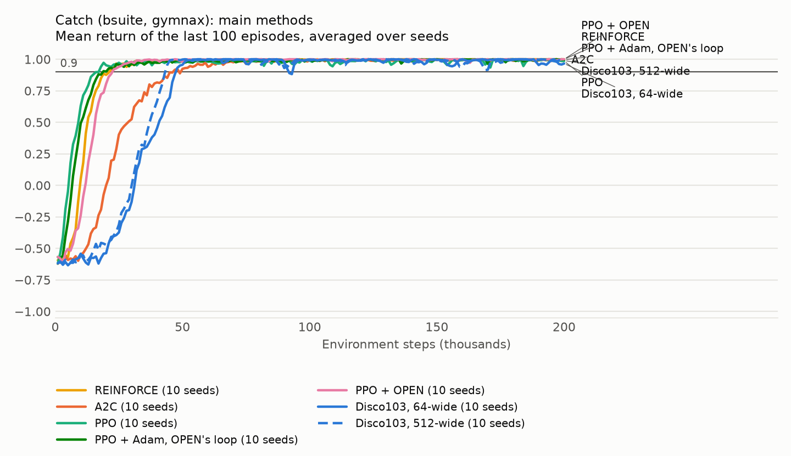

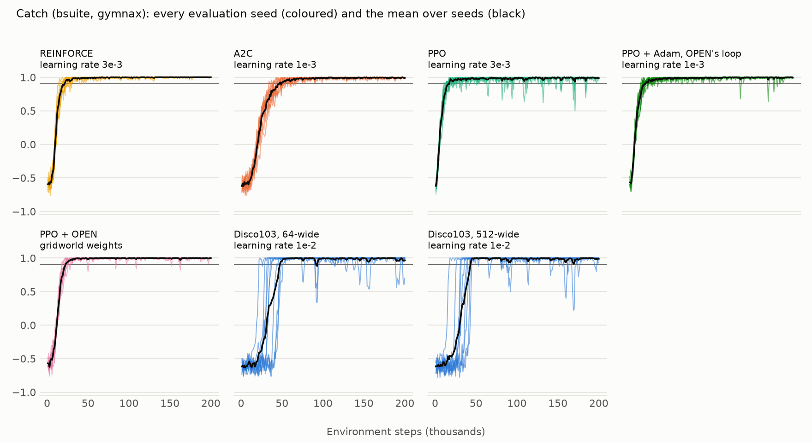

### Evaluation: Disco103 at replay ratio 4

| Method | Setting | Seeds | Final return, mean (min..max) | Each seed | Episodes with return ≥ 0.9 | Step at which the trailing mean first reached 0.9 |
|---|---|---|---|---|---|---|
| Disco103, 64-wide, replay ratio 4 | learning rate 1e-2 | 10 | −0.30 (−0.64..0.56) | −0.54, −0.20, −0.56, −0.06, −0.40, 0.56, −0.54, −0.08, −0.64, −0.50 | 35% | never, never, never, never, never, never, never, never, never, never |
| Disco103, 512-wide, replay ratio 4 | learning rate 3e-3 | 10 | −0.40 (−0.68..0.08) | −0.62, −0.28, −0.64, −0.48, −0.54, −0.46, −0.34, −0.02, −0.68, 0.08 | 30% | never, never, never, never, never, never, never, never, never, never |

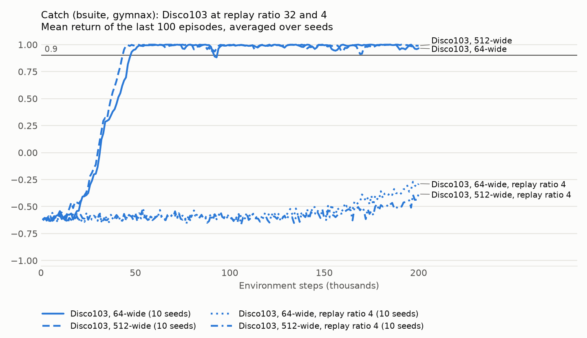

### Evaluation: baselines with 512×512 networks

| Method | Setting | Seeds | Final return, mean (min..max) | Each seed | Episodes with return ≥ 0.9 | Step at which the trailing mean first reached 0.9 |
|---|---|---|---|---|---|---|
| REINFORCE, 512-wide | learning rate 1e-3 | 10 | 1.00 (1.00..1.00) | 1.00, 1.00, 1.00, 1.00, 1.00, 1.00, 1.00, 1.00, 1.00, 1.00 | 100% | 20k, 13k, 19k, 16k, 17k, 11k, 13k, 12k, 14k, 15k |
| A2C, 512-wide | learning rate 3e-4 | 10 | 1.00 (0.98..1.00) | 1.00, 1.00, 0.98, 1.00, 1.00, 1.00, 1.00, 1.00, 1.00, 1.00 | 100% | 38k, 33k, 40k, 35k, 37k, 42k, 33k, 41k, 40k, 33k |
| PPO, 512-wide | learning rate 3e-4 | 10 | 0.98 (0.96..1.00) | 1.00, 0.96, 1.00, 0.98, 0.98, 0.96, 0.98, 0.98, 1.00, 1.00 | 99% | 18k, 19k, 18k, 17k, 16k, 16k, 18k, 17k, 14k, 15k |

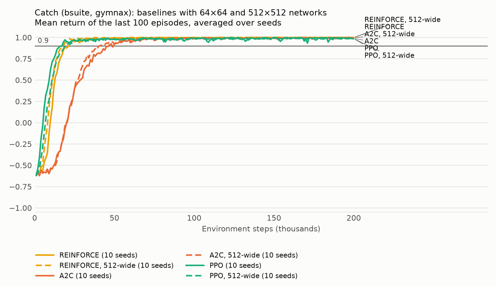

### Search

Final return of every search run.

| Method | Setting | Seed 0 | Seed 1 | Seed 2 | Mean |
|---|---|---|---|---|---|
| REINFORCE | learning rate 1e-3 | 1.00 | 1.00 | 1.00 | 1.00 |
| REINFORCE | learning rate 3e-3 (chosen) | 1.00 | 1.00 | 1.00 | 1.00 |
| REINFORCE | learning rate 1e-2 | 0.62 | 1.00 | 1.00 | 0.87 |
| A2C | learning rate 1e-4 | 0.20 | 0.36 | 0.36 | 0.31 |
| A2C | learning rate 3e-4 | 1.00 | 0.98 | 1.00 | 0.99 |
| A2C | learning rate 1e-3 (chosen) | 0.98 | 1.00 | 1.00 | 0.99 |
| A2C | learning rate 3e-3 | 0.66 | 1.00 | 1.00 | 0.89 |
| PPO | learning rate 3e-4 | 1.00 | 1.00 | 1.00 | 1.00 |
| PPO | learning rate 1e-3 | 1.00 | 0.98 | 1.00 | 0.99 |
| PPO | learning rate 3e-3 (chosen) | 1.00 | 1.00 | 1.00 | 1.00 |
| PPO | learning rate 1e-2 | 1.00 | 0.86 | 0.96 | 0.94 |
| PPO + Adam, OPEN's loop | learning rate 1e-4 | 1.00 | 0.94 | 1.00 | 0.98 |
| PPO + Adam, OPEN's loop | learning rate 3e-4 | 1.00 | 1.00 | 1.00 | 1.00 |
| PPO + Adam, OPEN's loop | learning rate 1e-3 (chosen) | 1.00 | 1.00 | 1.00 | 1.00 |
| PPO + Adam, OPEN's loop | learning rate 3e-3 | 1.00 | 0.98 | 1.00 | 0.99 |
| PPO + OPEN | gridworld weights (chosen) | 1.00 | 1.00 | 1.00 | 1.00 |
| PPO + OPEN | multi weights | 1.00 | 0.98 | 0.98 | 0.99 |
| Disco103, 64-wide | learning rate 1e-3 | 1.00 | 1.00 | 1.00 | 1.00 |
| Disco103, 64-wide | learning rate 3e-3 | 0.66 | 0.70 | 1.00 | 0.79 |
| Disco103, 64-wide | learning rate 1e-2 (chosen) | 1.00 | 1.00 | 1.00 | 1.00 |
| Disco103, 64-wide | learning rate 3e-2 | 0.94 | 0.74 | 1.00 | 0.89 |
| Disco103, 512-wide | learning rate 1e-3 | 1.00 | 1.00 | 1.00 | 1.00 |
| Disco103, 512-wide | learning rate 3e-3 | 0.86 | 1.00 | 1.00 | 0.95 |
| Disco103, 512-wide | learning rate 1e-2 (chosen) | 1.00 | 1.00 | 1.00 | 1.00 |
| Disco103, 512-wide | learning rate 3e-2 | −0.58 | −0.48 | −0.58 | −0.55 |
| REINFORCE, 512-wide | learning rate 1e-4 | 1.00 | 0.96 | 0.98 | 0.98 |
| REINFORCE, 512-wide | learning rate 3e-4 | 1.00 | 1.00 | 1.00 | 1.00 |
| REINFORCE, 512-wide | learning rate 1e-3 (chosen) | 1.00 | 1.00 | 1.00 | 1.00 |
| REINFORCE, 512-wide | learning rate 3e-3 | 0.62 | 1.00 | 1.00 | 0.87 |
| A2C, 512-wide | learning rate 1e-4 | 1.00 | 0.98 | 1.00 | 0.99 |
| A2C, 512-wide | learning rate 3e-4 (chosen) | 0.98 | 1.00 | 1.00 | 0.99 |
| A2C, 512-wide | learning rate 1e-3 | 0.98 | 1.00 | 0.94 | 0.97 |
| PPO, 512-wide | learning rate 1e-4 | 1.00 | 1.00 | 1.00 | 1.00 |
| PPO, 512-wide | learning rate 3e-4 (chosen) | 1.00 | 1.00 | 1.00 | 1.00 |
| PPO, 512-wide | learning rate 1e-3 | 0.98 | 0.98 | 1.00 | 0.99 |
| PPO, 512-wide | learning rate 3e-3 | −0.56 | 0.46 | 1.00 | 0.30 |
| Disco103, 64-wide, replay ratio 4 | learning rate 1e-3 | −0.52 | −0.70 | −0.58 | −0.60 |
| Disco103, 64-wide, replay ratio 4 | learning rate 3e-3 | −0.62 | −0.62 | −0.60 | −0.61 |
| Disco103, 64-wide, replay ratio 4 | learning rate 1e-2 (chosen) | 0.54 | 0.42 | −0.46 | 0.17 |
| Disco103, 64-wide, replay ratio 4 | learning rate 3e-2 | −0.54 | −0.42 | 0.66 | −0.10 |
| Disco103, 512-wide, replay ratio 4 | learning rate 1e-3 | −0.58 | −0.66 | −0.56 | −0.60 |
| Disco103, 512-wide, replay ratio 4 | learning rate 3e-3 (chosen) | 0.62 | −0.66 | −0.56 | −0.20 |
| Disco103, 512-wide, replay ratio 4 | learning rate 1e-2 | −0.28 | −0.16 | −0.56 | −0.33 |
| Disco103, 512-wide, replay ratio 4 | learning rate 3e-2 | −0.52 | −0.70 | −0.58 | −0.60 |

## CartPole-v1 (gymnax)

500,000 environment steps per run, 16 environments.

### Evaluation: main methods

| Method | Setting | Seeds | Final return, mean (min..max) | Each seed | Episodes with return ≥ 475 | Step at which the trailing mean first reached 475 |
|---|---|---|---|---|---|---|
| Disco103, 512-wide | learning rate 1e-3 | 10 | 495 (457..500) | 496, 500, 500, 500, 500, 457, 500, 497, 500, 500 | 98% | 101k, 155k, 77k, 181k, 115k, 108k, 104k, 160k, 96k, 119k |
| Disco103, 64-wide | learning rate 1e-3 | 10 | 494 (472..500) | 500, 499, 500, 500, 495, 500, 480, 494, 496, 472 | 95% | 152k, 124k, 185k, 166k, 185k, 130k, 177k, 166k, 201k, 170k |
| PPO | learning rate 3e-4 | 10 | 481 (437..500) | 473, 500, 479, 437, 484, 495, 491, 494, 473, 485 | 93% | 188k, 169k, 398k, 180k, 263k, 260k, 197k, 238k, 233k, 411k |
| A2C | learning rate 1e-3 | 10 | 461 (360..500) | 421, 360, 474, 439, 495, 491, 489, 500, 451, 491 | 86% | 235k, 377k, 368k, 441k, 189k, 166k, 167k, 171k, 237k, 382k |
| PPO + Adam, OPEN's loop | learning rate 1e-4 | 10 | 455 (160..495) | 494, 484, 488, 487, 489, 495, 492, 477, 160, 481 | 85% | 323k, 325k, 361k, 479k, 333k, 224k, 423k, 357k, 267k, 326k |
| REINFORCE | learning rate 3e-3 | 10 | 434 (217..500) | 478, 500, 500, 217, 499, 487, 497, 497, 425, 245 | 70% | 130k, 119k, 172k, never, 216k, 291k, 185k, 119k, 173k, never |
| PPO + OPEN | gridworld weights | 10 | 424 (319..488) | 446, 323, 425, 450, 488, 431, 473, 419, 467, 319 | 68% | never, 191k, never, 271k, 445k, 156k, 223k, never, 113k, 186k |

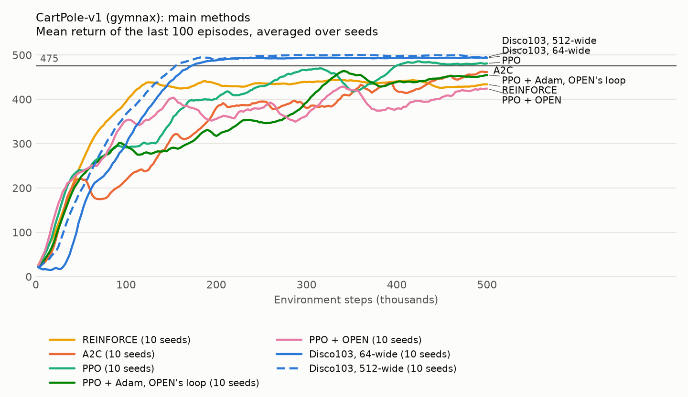

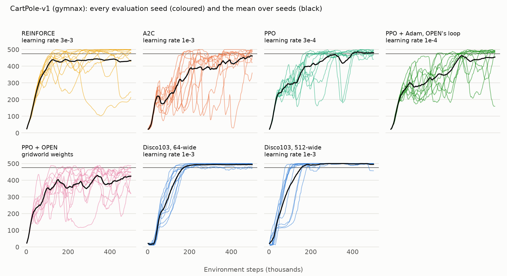

### Evaluation: Disco103 at replay ratio 4

| Method | Setting | Seeds | Final return, mean (min..max) | Each seed | Episodes with return ≥ 475 | Step at which the trailing mean first reached 475 |
|---|---|---|---|---|---|---|
| Disco103, 64-wide, replay ratio 4 | learning rate 1e-2 | 10 | 475 (366..500) | 500, 479, 497, 500, 500, 366, 492, 420, 498, 500 | 86% | 327k, 468k, 391k, 245k, 403k, never, 278k, never, 186k, 321k |
| Disco103, 512-wide, replay ratio 4 | learning rate 1e-2 | 10 | 431 (138..500) | 299, 500, 471, 466, 499, 138, 500, 490, 492, 458 | 78% | 292k, 443k, 136k, 127k, 371k, never, 275k, 314k, 249k, 148k |

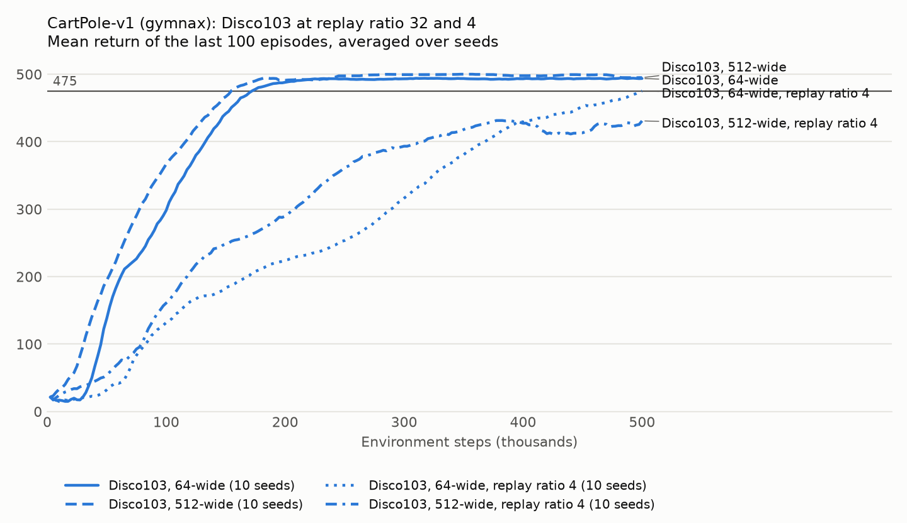

### Evaluation: baselines with 512×512 networks

| Method | Setting | Seeds | Final return, mean (min..max) | Each seed | Episodes with return ≥ 475 | Step at which the trailing mean first reached 475 |
|---|---|---|---|---|---|---|
| PPO, 512-wide | learning rate 3e-4 | 10 | 467 (331..500) | 477, 497, 500, 331, 462, 445, 493, 489, 488, 489 | 88% | 105k, 141k, 148k, 75k, 82k, 85k, 75k, 106k, 158k, 98k |
| REINFORCE, 512-wide | learning rate 3e-4 | 10 | 465 (324..500) | 457, 496, 500, 497, 449, 473, 494, 468, 490, 324 | 79% | never, 279k, 276k, 195k, 207k, 242k, 325k, 282k, 186k, 273k |
| A2C, 512-wide | learning rate 1e-3 | 10 | 336 (107..476) | 240, 119, 459, 373, 437, 325, 107, 464, 476, 360 | 53% | never, never, 96k, 119k, 129k, 238k, 136k, 225k, 424k, 403k |

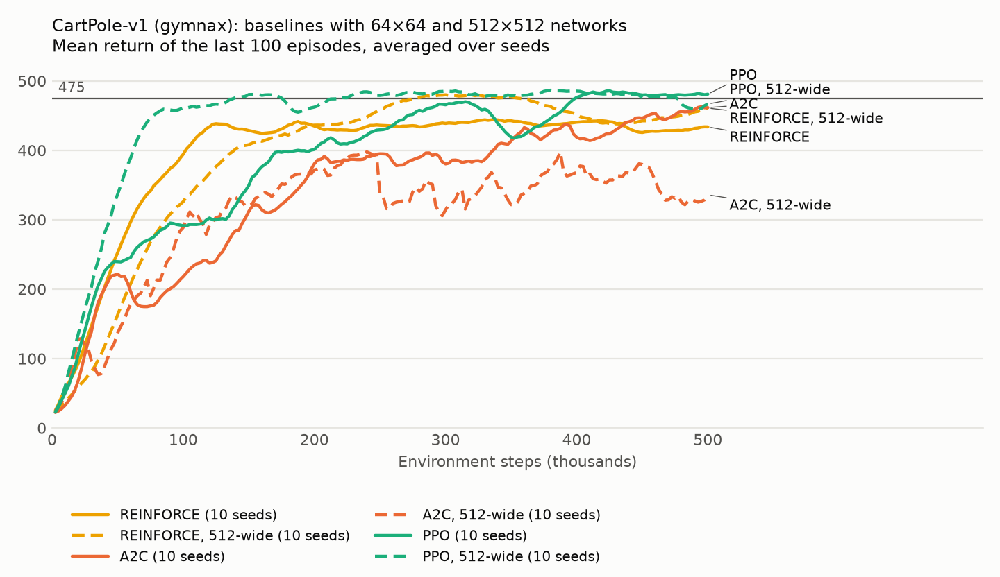

### Search

Final return of every search run.

| Method | Setting | Seed 0 | Seed 1 | Seed 2 | Mean |
|---|---|---|---|---|---|
| REINFORCE | learning rate 1e-3 | 498 | 425 | 493 | 472 |
| REINFORCE | learning rate 3e-3 (chosen) | 500 | 500 | 497 | 499 |
| REINFORCE | learning rate 1e-2 | 354 | 500 | 435 | 430 |
| A2C | learning rate 1e-4 | 183 | 244 | 137 | 188 |
| A2C | learning rate 3e-4 | 463 | 257 | 255 | 325 |
| A2C | learning rate 1e-3 (chosen) | 482 | 374 | 480 | 445 |
| A2C | learning rate 3e-3 | 218 | 483 | 379 | 360 |
| PPO | learning rate 1e-4 | 483 | 464 | 422 | 456 |
| PPO | learning rate 3e-4 (chosen) | 467 | 470 | 498 | 478 |
| PPO | learning rate 1e-3 | 453 | 451 | 468 | 457 |
| PPO | learning rate 3e-3 | 500 | 485 | 447 | 477 |
| PPO + Adam, OPEN's loop | learning rate 3e-5 | 220 | 268 | 239 | 242 |
| PPO + Adam, OPEN's loop | learning rate 1e-4 (chosen) | 486 | 489 | 490 | 488 |
| PPO + Adam, OPEN's loop | learning rate 3e-4 | 468 | 472 | 435 | 458 |
| PPO + Adam, OPEN's loop | learning rate 1e-3 | 491 | 458 | 416 | 455 |
| PPO + Adam, OPEN's loop | learning rate 3e-3 | 347 | 458 | 418 | 408 |
| PPO + OPEN | gridworld weights (chosen) | 417 | 450 | 323 | 397 |
| PPO + OPEN | multi weights | 368 | 301 | 303 | 324 |
| Disco103, 64-wide | learning rate 3e-4 | 500 | 500 | 472 | 491 |
| Disco103, 64-wide | learning rate 1e-3 (chosen) | 500 | 492 | 500 | 497 |
| Disco103, 64-wide | learning rate 3e-3 | 497 | 460 | 500 | 486 |
| Disco103, 64-wide | learning rate 1e-2 | 500 | 493 | 480 | 491 |
| Disco103, 512-wide | learning rate 3e-4 | 500 | 500 | 500 | 500 |
| Disco103, 512-wide | learning rate 1e-3 (chosen) | 500 | 500 | 500 | 500 |
| Disco103, 512-wide | learning rate 3e-3 | 495 | 496 | 493 | 494 |
| Disco103, 512-wide | learning rate 1e-2 | 489 | 500 | 500 | 496 |
| REINFORCE, 512-wide | learning rate 1e-4 | 472 | 466 | 478 | 472 |
| REINFORCE, 512-wide | learning rate 3e-4 (chosen) | 497 | 492 | 491 | 493 |
| REINFORCE, 512-wide | learning rate 1e-3 | 500 | 418 | 140 | 353 |
| REINFORCE, 512-wide | learning rate 3e-3 | 98 | 500 | 417 | 339 |
| A2C, 512-wide | learning rate 1e-4 | 484 | 471 | 437 | 464 |
| A2C, 512-wide | learning rate 3e-4 | 423 | 500 | 478 | 467 |
| A2C, 512-wide | learning rate 1e-3 (chosen) | 500 | 477 | 487 | 488 |
| A2C, 512-wide | learning rate 3e-3 | 135 | 9 | 371 | 172 |
| PPO, 512-wide | learning rate 1e-4 | 487 | 492 | 487 | 489 |
| PPO, 512-wide | learning rate 3e-4 (chosen) | 500 | 500 | 487 | 496 |
| PPO, 512-wide | learning rate 1e-3 | 470 | 500 | 500 | 490 |
| PPO, 512-wide | learning rate 3e-3 | 473 | 9 | 495 | 326 |
| Disco103, 64-wide, replay ratio 4 | learning rate 1e-3 | 117 | 157 | 297 | 190 |
| Disco103, 64-wide, replay ratio 4 | learning rate 3e-3 | 499 | 500 | 500 | 500 |
| Disco103, 64-wide, replay ratio 4 | learning rate 1e-2 (chosen) | 500 | 500 | 500 | 500 |
| Disco103, 64-wide, replay ratio 4 | learning rate 3e-2 | 500 | 431 | 100 | 343 |
| Disco103, 512-wide, replay ratio 4 | learning rate 1e-3 | 211 | 155 | 386 | 251 |
| Disco103, 512-wide, replay ratio 4 | learning rate 3e-3 | 489 | 500 | 500 | 496 |
| Disco103, 512-wide, replay ratio 4 | learning rate 1e-2 (chosen) | 500 | 500 | 500 | 500 |
| Disco103, 512-wide, replay ratio 4 | learning rate 3e-2 | 500 | 498 | 500 | 499 |

## Acrobot-v1 (gymnax)

500,000 environment steps per run, 16 environments.

### Evaluation: main methods

| Method | Setting | Seeds | Final return, mean (min..max) | Each seed | Episodes with return ≥ −100 | Step at which the trailing mean first reached −100 |
|---|---|---|---|---|---|---|
| PPO | learning rate 1e-3 | 10 | −81 (−84..−79) | −79, −81, −81, −80, −84, −79, −83, −84, −79, −81 | 92% | 34k, 37k, 62k, 40k, 36k, 39k, 107k, 43k, 38k, 105k |
| PPO + Adam, OPEN's loop | learning rate 3e-3 | 10 | −82 (−90..−76) | −79, −80, −84, −78, −90, −85, −85, −82, −76, −79 | 89% | 60k, 69k, 63k, 31k, 161k, 69k, 67k, 54k, 63k, 69k |
| A2C | learning rate 3e-3 | 10 | −85 (−92..−82) | −84, −85, −84, −84, −87, −82, −92, −83, −82, −83 | 91% | 82k, 68k, 21k, 54k, 48k, 39k, 26k, 102k, 69k, 170k |
| Disco103, 512-wide | learning rate 3e-3 | 10 | −91 (−95..−89) | −92, −89, −89, −89, −95, −91, −92, −91, −93, −90 | 77% | 166k, 80k, 73k, 128k, 99k, 102k, 102k, 54k, 175k, 83k |
| Disco103, 64-wide | learning rate 3e-3 | 10 | −94 (−97..−91) | −97, −93, −92, −96, −91, −96, −95, −92, −94, −93 | 72% | 128k, 59k, 94k, 103k, 112k, 115k, 136k, 86k, 46k, 96k |
| PPO + OPEN | gridworld weights | 10 | −122 (−500..−75) | −81, −81, −500, −75, −83, −84, −81, −76, −79, −83 | 85% | 44k, 35k, never, 121k, 24k, 87k, 124k, 127k, 61k, 38k |
| REINFORCE | learning rate 3e-3 | 10 | −254 (−500..−84) | −500, −500, −100, −93, −500, −84, −86, −91, −500, −84 | 50% | never, never, 277k, 353k, never, 206k, 131k, 347k, never, 191k |

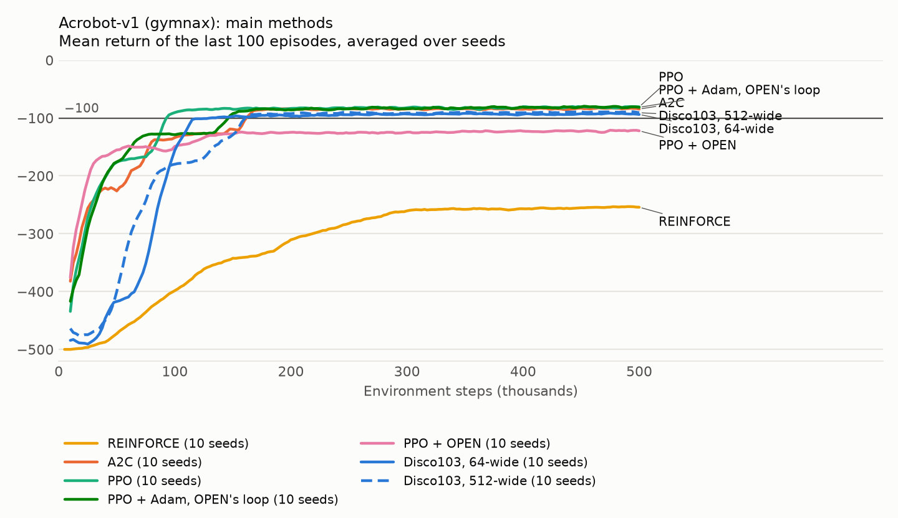

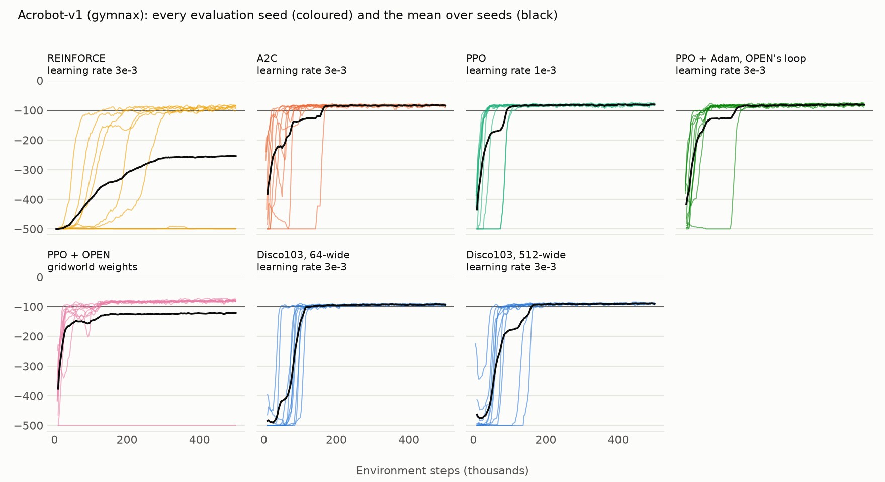

### Evaluation: Disco103 at replay ratio 4

| Method | Setting | Seeds | Final return, mean (min..max) | Each seed | Episodes with return ≥ −100 | Step at which the trailing mean first reached −100 |
|---|---|---|---|---|---|---|
| Disco103, 64-wide, replay ratio 4 | learning rate 3e-3 | 10 | −363 (−500..−108) | −474, −500, −477, −169, −108, −285, −495, −489, −129, −500 | 8% | never, never, never, never, never, never, never, never, never, never |
| Disco103, 512-wide, replay ratio 4 | learning rate 1e-3 | 10 | −463 (−500..−350) | −350, −435, −479, −500, −462, −493, −449, −498, −493, −472 | 0% | never, never, never, never, never, never, never, never, never, never |

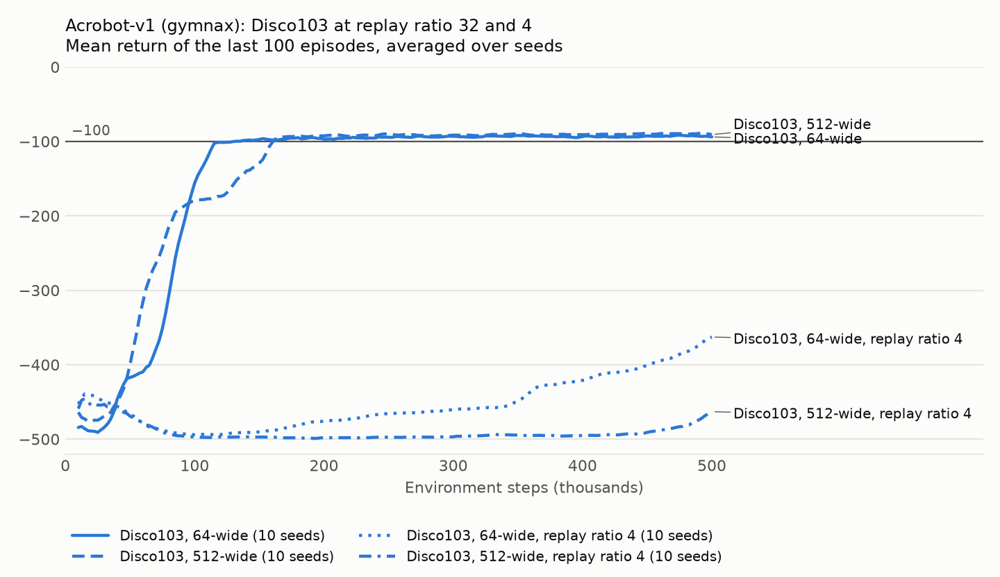

### Evaluation: baselines with 512×512 networks

| Method | Setting | Seeds | Final return, mean (min..max) | Each seed | Episodes with return ≥ −100 | Step at which the trailing mean first reached −100 |
|---|---|---|---|---|---|---|
| PPO, 512-wide | learning rate 3e-4 | 10 | −81 (−85..−75) | −75, −79, −82, −83, −82, −82, −84, −78, −77, −85 | 92% | 23k, 24k, 31k, 34k, 30k, 35k, 35k, 33k, 28k, 27k |
| A2C, 512-wide | learning rate 1e-3 | 10 | −93 (−152..−81) | −85, −88, −87, −81, −83, −104, −84, −86, −152, −84 | 80% | 20k, 14k, 22k, 16k, 23k, 15k, 20k, 18k, 13k, 16k |
| REINFORCE, 512-wide | learning rate 1e-3 | 10 | −212 (−500..−84) | −90, −500, −90, −84, −500, −85, −87, −90, −500, −89 | 60% | 492k, never, 157k, 144k, never, 96k, 71k, 209k, never, 90k |

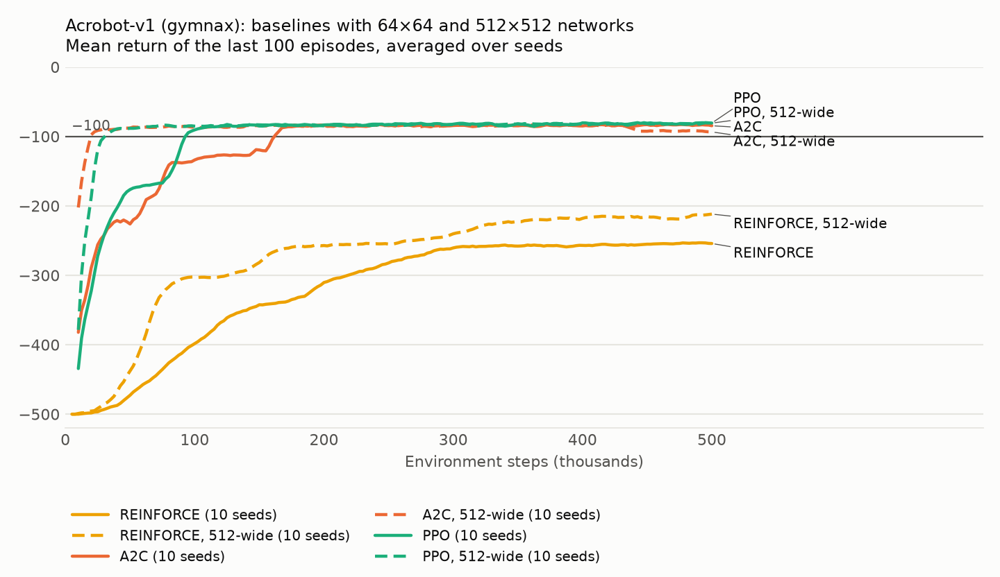

### Search

Final return of every search run.

| Method | Setting | Seed 0 | Seed 1 | Seed 2 | Mean |
|---|---|---|---|---|---|
| REINFORCE | learning rate 1e-3 | −110 | −100 | −102 | −104 |
| REINFORCE | learning rate 3e-3 (chosen) | −87 | −89 | −93 | −90 |
| REINFORCE | learning rate 1e-2 | −500 | −109 | −83 | −231 |
| A2C | learning rate 1e-4 | −105 | −117 | −109 | −110 |
| A2C | learning rate 3e-4 | −89 | −83 | −91 | −88 |
| A2C | learning rate 1e-3 | −87 | −84 | −84 | −85 |
| A2C | learning rate 3e-3 (chosen) | −86 | −82 | −85 | −84 |
| A2C | learning rate 1e-2 | −500 | −500 | −500 | −500 |
| PPO | learning rate 3e-4 | −88 | −81 | −84 | −84 |
| PPO | learning rate 1e-3 (chosen) | −82 | −84 | −79 | −82 |
| PPO | learning rate 3e-3 | −80 | −86 | −84 | −83 |
| PPO + Adam, OPEN's loop | learning rate 1e-4 | −85 | −83 | −83 | −83 |
| PPO + Adam, OPEN's loop | learning rate 3e-4 | −88 | −89 | −86 | −88 |
| PPO + Adam, OPEN's loop | learning rate 1e-3 | −84 | −81 | −79 | −82 |
| PPO + Adam, OPEN's loop | learning rate 3e-3 (chosen) | −84 | −78 | −83 | −82 |
| PPO + Adam, OPEN's loop | learning rate 1e-2 | −84 | −85 | −83 | −84 |
| PPO + OPEN | gridworld weights (chosen) | −72 | −73 | −78 | −74 |
| PPO + OPEN | multi weights | −89 | −85 | −97 | −90 |
| Disco103, 64-wide | learning rate 1e-3 | −106 | −95 | −94 | −98 |
| Disco103, 64-wide | learning rate 3e-3 (chosen) | −92 | −94 | −95 | −94 |
| Disco103, 64-wide | learning rate 1e-2 | −93 | −95 | −94 | −94 |
| Disco103, 512-wide | learning rate 1e-3 | −89 | −92 | −91 | −91 |
| Disco103, 512-wide | learning rate 3e-3 (chosen) | −90 | −90 | −88 | −89 |
| Disco103, 512-wide | learning rate 1e-2 | −94 | −94 | −95 | −94 |
| REINFORCE, 512-wide | learning rate 1e-4 | −167 | −497 | −150 | −271 |
| REINFORCE, 512-wide | learning rate 3e-4 | −93 | −484 | −92 | −223 |
| REINFORCE, 512-wide | learning rate 1e-3 (chosen) | −92 | −461 | −83 | −212 |
| REINFORCE, 512-wide | learning rate 3e-3 | −82 | −500 | −500 | −361 |
| A2C, 512-wide | learning rate 1e-4 | −81 | −85 | −89 | −85 |
| A2C, 512-wide | learning rate 3e-4 | −83 | −82 | −83 | −83 |
| A2C, 512-wide | learning rate 1e-3 (chosen) | −83 | −80 | −81 | −82 |
| A2C, 512-wide | learning rate 3e-3 | −103 | −500 | −500 | −368 |
| PPO, 512-wide | learning rate 1e-4 | −84 | −84 | −87 | −85 |
| PPO, 512-wide | learning rate 3e-4 (chosen) | −80 | −82 | −83 | −82 |
| PPO, 512-wide | learning rate 1e-3 | −83 | −83 | −86 | −84 |
| PPO, 512-wide | learning rate 3e-3 | −148 | −500 | −88 | −245 |
| Disco103, 64-wide, replay ratio 4 | learning rate 1e-3 | −500 | −500 | −500 | −500 |
| Disco103, 64-wide, replay ratio 4 | learning rate 3e-3 (chosen) | −142 | −447 | −495 | −361 |
| Disco103, 64-wide, replay ratio 4 | learning rate 1e-2 | −500 | −477 | −500 | −492 |
| Disco103, 64-wide, replay ratio 4 | learning rate 3e-2 | −499 | −494 | −495 | −496 |
| Disco103, 512-wide, replay ratio 4 | learning rate 3e-4 | −500 | −493 | −492 | −495 |
| Disco103, 512-wide, replay ratio 4 | learning rate 1e-3 (chosen) | −165 | −500 | −500 | −388 |
| Disco103, 512-wide, replay ratio 4 | learning rate 3e-3 | −409 | −499 | −492 | −467 |
| Disco103, 512-wide, replay ratio 4 | learning rate 1e-2 | −465 | −495 | −493 | −485 |
| Disco103, 512-wide, replay ratio 4 | learning rate 3e-2 | −500 | −495 | −492 | −495 |

## FourRooms (gymnax)

300,000 environment steps per run, 16 environments.

### Evaluation: main methods

| Method | Setting | Seeds | Final return, mean (min..max) | Each seed | Episodes with return ≥ 0.9 | Step at which the trailing mean first reached 0.9 |
|---|---|---|---|---|---|---|
| PPO | learning rate 3e-3 | 10 | 1.00 (1.00..1.00) | 1.00, 1.00, 1.00, 1.00, 1.00, 1.00, 1.00, 1.00, 1.00, 1.00 | 100% | 19k, 44k, 22k, 23k, 16k, 98k, 26k, 26k, 17k, 46k |
| PPO + OPEN | multi weights | 10 | 1.00 (1.00..1.00) | 1.00, 1.00, 1.00, 1.00, 1.00, 1.00, 1.00, 1.00, 1.00, 1.00 | 100% | 46k, 22k, 26k, 32k, 40k, 23k, 32k, 25k, 25k, 24k |
| A2C | learning rate 1e-3 | 10 | 1.00 (0.99..1.00) | 1.00, 1.00, 1.00, 1.00, 1.00, 1.00, 1.00, 1.00, 0.99, 1.00 | 100% | 29k, 27k, 32k, 25k, 25k, 31k, 27k, 23k, 28k, 41k |
| Disco103, 512-wide | learning rate 3e-3 | 10 | 1.00 (0.98..1.00) | 1.00, 1.00, 1.00, 1.00, 1.00, 1.00, 0.98, 1.00, 1.00, 1.00 | 100% | 82k, 122k, 129k, 72k, 114k, 55k, 123k, 72k, 124k, 70k |
| REINFORCE | learning rate 1e-3 | 10 | 0.97 (0.92..0.99) | 0.97, 0.99, 0.94, 0.92, 0.99, 0.97, 0.94, 0.98, 0.99, 0.98 | 97% | 80k, 64k, 87k, 81k, 79k, 69k, 74k, 76k, 130k, 93k |
| PPO + Adam, OPEN's loop | learning rate 1e-3 | 10 | 0.90 (0.00..1.00) | 1.00, 1.00, 1.00, 1.00, 0.00, 1.00, 1.00, 1.00, 1.00, 1.00 | 90% | 38k, 19k, 17k, 60k, never, 17k, 21k, 17k, 17k, 20k |
| Disco103, 64-wide | learning rate 3e-3 | 10 | 0.85 (0.00..1.00) | 1.00, 0.00, 1.00, 0.99, 0.56, 1.00, 0.93, 1.00, 1.00, 1.00 | 85% | 165k, never, 131k, 132k, never, 64k, 247k, 178k, 142k, 92k |

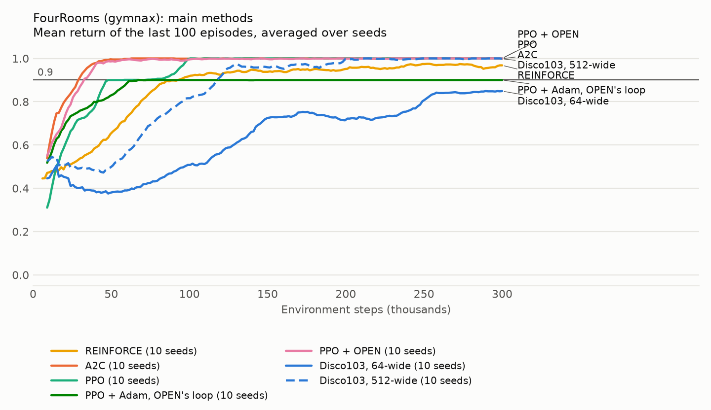

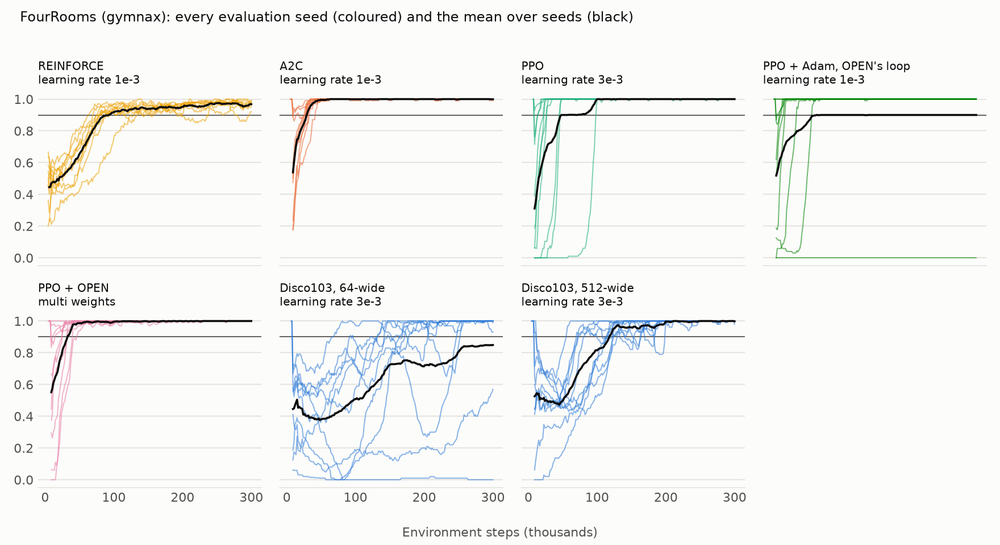

### Evaluation: Disco103 at replay ratio 4

| Method | Setting | Seeds | Final return, mean (min..max) | Each seed | Episodes with return ≥ 0.9 | Step at which the trailing mean first reached 0.9 |
|---|---|---|---|---|---|---|
| Disco103, 512-wide, replay ratio 4 | learning rate 3e-3 | 10 | 0.63 (0.40..0.95) | 0.62, 0.52, 0.77, 0.60, 0.95, 0.52, 0.64, 0.57, 0.40, 0.70 | 63% | never, never, never, never, 299k, never, never, never, never, never |
| Disco103, 64-wide, replay ratio 4 | learning rate 3e-2 | 10 | 0.58 (0.42..0.72) | 0.42, 0.59, 0.49, 0.60, 0.67, 0.55, 0.72, 0.64, 0.54, 0.59 | 58% | never, never, never, never, 219k, never, never, never, never, never |

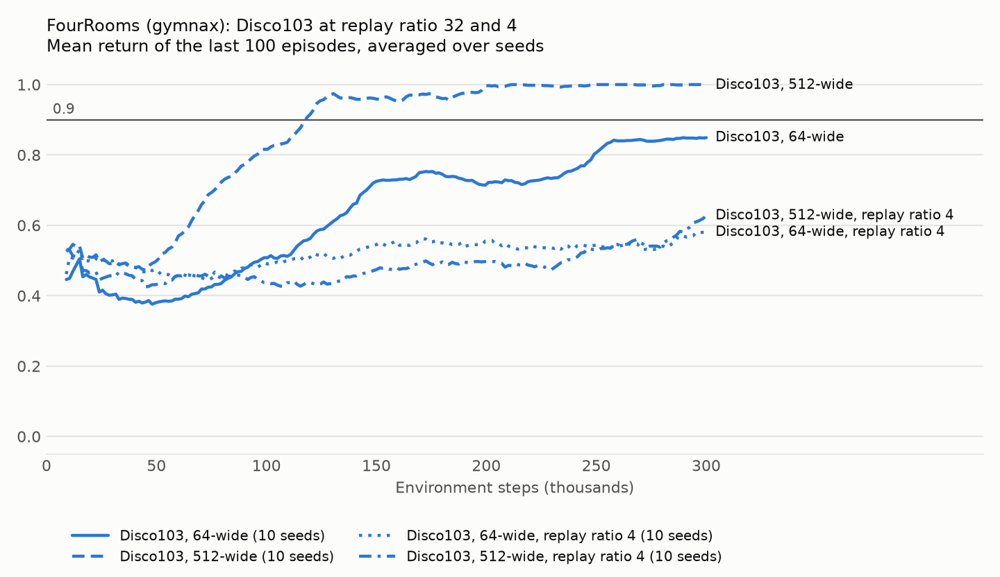

### Evaluation: baselines with 512×512 networks

| Method | Setting | Seeds | Final return, mean (min..max) | Each seed | Episodes with return ≥ 0.9 | Step at which the trailing mean first reached 0.9 |
|---|---|---|---|---|---|---|
| PPO, 512-wide | learning rate 1e-3 | 10 | 1.00 (1.00..1.00) | 1.00, 1.00, 1.00, 1.00, 1.00, 1.00, 1.00, 1.00, 1.00, 1.00 | 100% | 20k, 18k, 21k, 16k, 18k, 16k, 21k, 21k, 19k, 17k |
| A2C, 512-wide | learning rate 3e-4 | 10 | 1.00 (0.99..1.00) | 0.99, 1.00, 1.00, 1.00, 1.00, 1.00, 1.00, 1.00, 1.00, 1.00 | 100% | 22k, 25k, 25k, 24k, 23k, 28k, 24k, 24k, 25k, 25k |
| REINFORCE, 512-wide | learning rate 3e-4 | 10 | 0.96 (0.89..1.00) | 1.00, 0.98, 0.99, 0.97, 0.96, 0.89, 1.00, 0.92, 0.89, 1.00 | 96% | 74k, 42k, 70k, 51k, 67k, 38k, 49k, 89k, 72k, 72k |

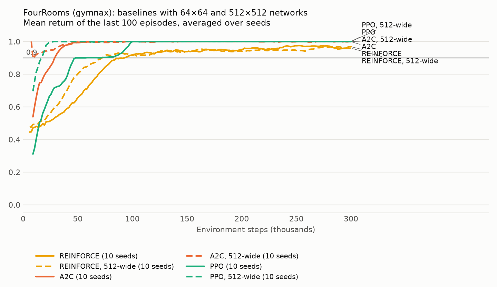

### Search

Final return of every search run.

| Method | Setting | Seed 0 | Seed 1 | Seed 2 | Mean |
|---|---|---|---|---|---|
| REINFORCE | learning rate 3e-4 | 0.94 | 0.96 | 0.92 | 0.94 |
| REINFORCE | learning rate 1e-3 (chosen) | 0.96 | 0.96 | 0.97 | 0.96 |
| REINFORCE | learning rate 3e-3 | 0.93 | 0.95 | 0.98 | 0.95 |
| REINFORCE | learning rate 1e-2 | 0.11 | 0.08 | 0.96 | 0.38 |
| A2C | learning rate 1e-4 | 1.00 | 1.00 | 1.00 | 1.00 |
| A2C | learning rate 3e-4 | 1.00 | 1.00 | 1.00 | 1.00 |
| A2C | learning rate 1e-3 (chosen) | 1.00 | 1.00 | 1.00 | 1.00 |
| A2C | learning rate 3e-3 | 0.99 | 1.00 | 1.00 | 1.00 |
| PPO | learning rate 3e-4 | 1.00 | 1.00 | 1.00 | 1.00 |
| PPO | learning rate 1e-3 | 1.00 | 1.00 | 1.00 | 1.00 |
| PPO | learning rate 3e-3 (chosen) | 1.00 | 1.00 | 1.00 | 1.00 |
| PPO | learning rate 1e-2 | 0.92 | 1.00 | 1.00 | 0.97 |
| PPO + Adam, OPEN's loop | learning rate 1e-4 | 1.00 | 1.00 | 1.00 | 1.00 |
| PPO + Adam, OPEN's loop | learning rate 3e-4 | 1.00 | 1.00 | 1.00 | 1.00 |
| PPO + Adam, OPEN's loop | learning rate 1e-3 (chosen) | 1.00 | 1.00 | 1.00 | 1.00 |
| PPO + Adam, OPEN's loop | learning rate 3e-3 | 0.99 | 1.00 | 1.00 | 1.00 |
| PPO + OPEN | gridworld weights | 1.00 | 1.00 | 1.00 | 1.00 |
| PPO + OPEN | multi weights (chosen) | 1.00 | 1.00 | 1.00 | 1.00 |
| Disco103, 64-wide | learning rate 1e-3 | 0.92 | 0.98 | 0.99 | 0.96 |
| Disco103, 64-wide | learning rate 3e-3 (chosen) | 1.00 | 1.00 | 1.00 | 1.00 |
| Disco103, 64-wide | learning rate 1e-2 | 0.99 | 0.73 | 1.00 | 0.91 |
| Disco103, 512-wide | learning rate 1e-3 | 1.00 | 1.00 | 1.00 | 1.00 |
| Disco103, 512-wide | learning rate 3e-3 (chosen) | 1.00 | 1.00 | 1.00 | 1.00 |
| Disco103, 512-wide | learning rate 1e-2 | 1.00 | 1.00 | 1.00 | 1.00 |
| REINFORCE, 512-wide | learning rate 1e-4 | 0.95 | 0.97 | 0.97 | 0.96 |
| REINFORCE, 512-wide | learning rate 3e-4 (chosen) | 1.00 | 0.98 | 0.98 | 0.99 |
| REINFORCE, 512-wide | learning rate 1e-3 | 1.00 | 0.92 | 1.00 | 0.97 |
| REINFORCE, 512-wide | learning rate 3e-3 | 0.99 | 0.00 | 0.00 | 0.33 |
| A2C, 512-wide | learning rate 1e-4 | 1.00 | 1.00 | 1.00 | 1.00 |
| A2C, 512-wide | learning rate 3e-4 (chosen) | 1.00 | 1.00 | 1.00 | 1.00 |
| A2C, 512-wide | learning rate 1e-3 | 0.99 | 1.00 | 1.00 | 1.00 |
| PPO, 512-wide | learning rate 1e-4 | 1.00 | 1.00 | 1.00 | 1.00 |
| PPO, 512-wide | learning rate 3e-4 | 1.00 | 1.00 | 1.00 | 1.00 |
| PPO, 512-wide | learning rate 1e-3 (chosen) | 1.00 | 1.00 | 1.00 | 1.00 |
| PPO, 512-wide | learning rate 3e-3 | 0.04 | 0.76 | 0.22 | 0.34 |
| Disco103, 64-wide, replay ratio 4 | learning rate 1e-3 | 0.57 | 0.57 | 0.54 | 0.56 |
| Disco103, 64-wide, replay ratio 4 | learning rate 3e-3 | 0.79 | 0.68 | 0.00 | 0.49 |
| Disco103, 64-wide, replay ratio 4 | learning rate 1e-2 | 0.70 | 0.62 | 0.02 | 0.45 |
| Disco103, 64-wide, replay ratio 4 | learning rate 3e-2 (chosen) | 0.57 | 0.61 | 0.56 | 0.58 |
| Disco103, 64-wide, replay ratio 4 | learning rate 1e-1 | 0.45 | 0.52 | 0.49 | 0.49 |
| Disco103, 512-wide, replay ratio 4 | learning rate 1e-3 | 0.58 | 0.48 | 0.50 | 0.52 |
| Disco103, 512-wide, replay ratio 4 | learning rate 3e-3 (chosen) | 0.75 | 0.60 | 0.41 | 0.59 |
| Disco103, 512-wide, replay ratio 4 | learning rate 1e-2 | 0.56 | 0.66 | 0.39 | 0.54 |
| Disco103, 512-wide, replay ratio 4 | learning rate 3e-2 | 0.55 | 0.51 | 0.48 | 0.51 |

## DeepSea, size 8 (bsuite, gymnax)

300,000 environment steps per run, 16 environments.

### Evaluation: main methods

| Method | Setting | Seeds | Final return, mean (min..max) | Each seed | Episodes with return ≥ 0.9 | Step at which the trailing mean first reached 0.9 |
|---|---|---|---|---|---|---|
| REINFORCE | learning rate 1e-3 | 10 | 0.99 (0.99..0.99) | 0.99, 0.99, 0.99, 0.99, 0.99, 0.99, 0.99, 0.99, 0.99, 0.99 | 100% | 15k, 12k, 12k, 16k, 11k, 11k, 11k, 16k, 12k, 13k |
| A2C | learning rate 1e-2 | 10 | 0.99 (0.99..0.99) | 0.99, 0.99, 0.99, 0.99, 0.99, 0.99, 0.99, 0.99, 0.99, 0.99 | 100% | 2k, 5k, 3k, 5k, 17k, 4k, 5k, 13k, 4k, 4k |
| PPO + Adam, OPEN's loop | learning rate 1e-3 | 10 | 0.89 (0.00..0.99) | 0.99, 0.99, 0.99, 0.99, 0.99, 0.99, 0.99, 0.00, 0.99, 0.99 | 90% | 7k, 7k, 7k, 8k, 6k, 6k, 6k, never, 6k, 8k |
| Disco103, 64-wide | learning rate 1e-2 | 10 | 0.88 (0.00..0.99) | 0.99, 0.99, 0.99, 0.99, 0.99, 0.00, 0.99, 0.96, 0.94, 0.99 | 89% | 89k, 19k, 34k, 25k, 14k, never, 49k, 24k, 51k, 17k |
| PPO + OPEN | multi weights | 10 | 0.87 (0.00..0.99) | 0.98, 0.97, 0.98, 0.98, 0.98, 0.98, 0.89, 0.00, 0.97, 0.99 | 88% | 8k, 7k, 8k, 9k, 8k, 7k, 7k, never, 7k, 10k |
| Disco103, 512-wide | learning rate 1e-2 | 10 | 0.84 (0.00..0.99) | 0.99, 0.99, 0.99, 0.58, 0.99, 0.99, 0.00, 0.93, 0.98, 0.99 | 85% | 29k, 36k, 29k, never, 37k, 4k, never, 298k, 25k, 26k |
| PPO | learning rate 3e-4 | 10 | 0.79 (0.00..0.99) | 0.99, 0.99, 0.99, 0.00, 0.00, 0.99, 0.99, 0.99, 0.99, 0.99 | 80% | 10k, 15k, 12k, never, never, 17k, 14k, 16k, 12k, 13k |

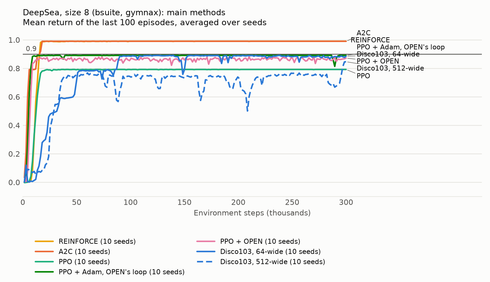

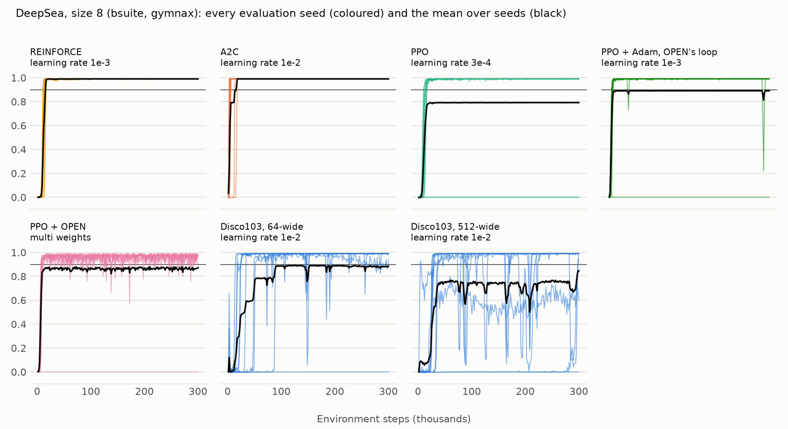

### Evaluation: Disco103 at replay ratio 4

| Method | Setting | Seeds | Final return, mean (min..max) | Each seed | Episodes with return ≥ 0.9 | Step at which the trailing mean first reached 0.9 |
|---|---|---|---|---|---|---|
| Disco103, 64-wide, replay ratio 4 | learning rate 3e-2 | 10 | 0.35 (−0.00..0.99) | −0.00, 0.02, 0.99, 0.43, 0.09, −0.00, −0.00, 0.99, −0.00, 0.99 | 36% | never, 4k, 186k, never, 4k, never, never, 222k, never, 74k |
| Disco103, 512-wide, replay ratio 4 | learning rate 3e-3 | 10 | 0.35 (−0.00..0.93) | −0.00, −0.00, 0.91, −0.00, 0.93, 0.80, −0.00, −0.00, 0.84, −0.00 | 35% | never, never, 211k, never, 296k, 5k, never, never, 4k, never |

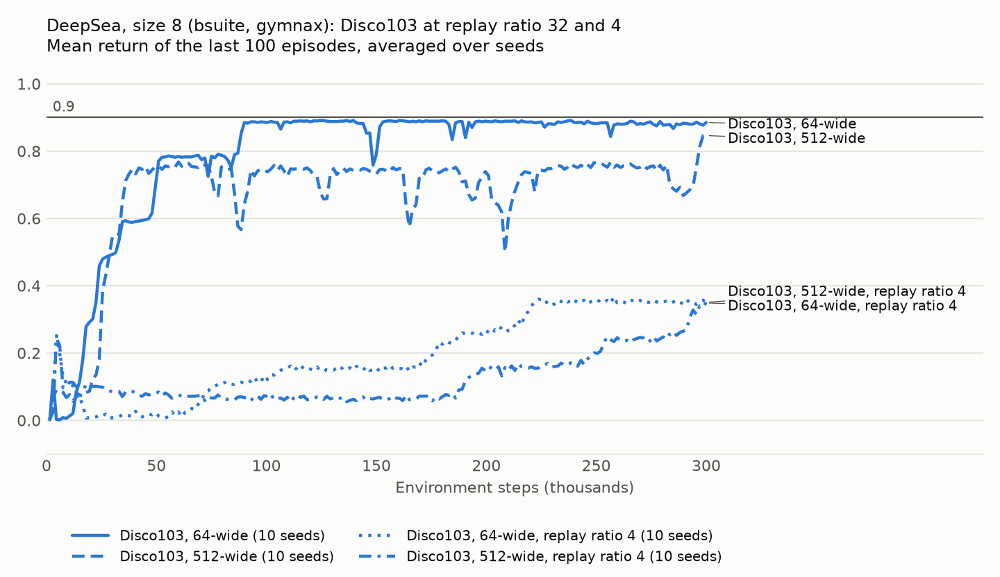

### Evaluation: baselines with 512×512 networks

| Method | Setting | Seeds | Final return, mean (min..max) | Each seed | Episodes with return ≥ 0.9 | Step at which the trailing mean first reached 0.9 |
|---|---|---|---|---|---|---|
| REINFORCE, 512-wide | learning rate 1e-4 | 10 | 0.99 (0.99..0.99) | 0.99, 0.99, 0.99, 0.99, 0.99, 0.99, 0.99, 0.99, 0.99, 0.99 | 100% | 24k, 23k, 22k, 24k, 22k, 21k, 23k, 23k, 22k, 23k |
| A2C, 512-wide | learning rate 3e-3 | 10 | 0.99 (0.99..0.99) | 0.99, 0.99, 0.99, 0.99, 0.99, 0.99, 0.99, 0.99, 0.99, 0.99 | 100% | 3k, 5k, 4k, 9k, 5k, 3k, 5k, 10k, 5k, 3k |
| PPO, 512-wide | learning rate 3e-5 | 10 | 0.89 (0.00..0.99) | 0.99, 0.99, 0.98, 0.99, 0.00, 0.99, 0.99, 0.99, 0.99, 0.99 | 90% | 23k, 26k, 22k, 22k, never, 25k, 22k, 34k, 21k, 23k |

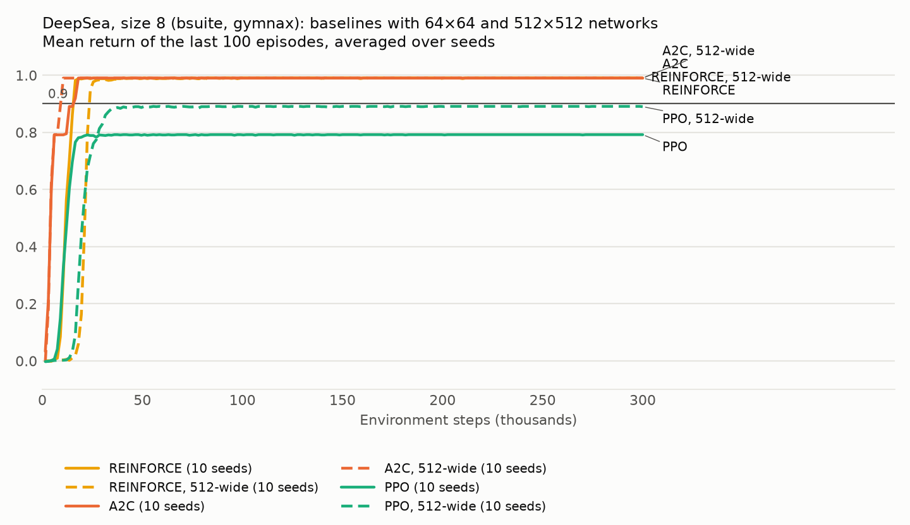

### Search

Final return of every search run.

| Method | Setting | Seed 0 | Seed 1 | Seed 2 | Mean |
|---|---|---|---|---|---|
| REINFORCE | learning rate 3e-4 | 0.99 | 0.99 | 0.99 | 0.99 |
| REINFORCE | learning rate 1e-3 (chosen) | 0.99 | 0.99 | 0.99 | 0.99 |
| REINFORCE | learning rate 3e-3 | 0.00 | 0.00 | 0.99 | 0.33 |
| REINFORCE | learning rate 1e-2 | 0.00 | 0.00 | 0.00 | 0.00 |
| A2C | learning rate 1e-4 | 0.99 | 0.98 | 0.99 | 0.99 |
| A2C | learning rate 3e-4 | 0.99 | 0.99 | 0.99 | 0.99 |
| A2C | learning rate 1e-3 | 0.99 | 0.99 | 0.99 | 0.99 |
| A2C | learning rate 3e-3 | 0.99 | 0.99 | 0.99 | 0.99 |
| A2C | learning rate 1e-2 (chosen) | 0.99 | 0.99 | 0.99 | 0.99 |
| A2C | learning rate 3e-2 | 0.00 | 0.99 | 0.99 | 0.66 |
| PPO | learning rate 1e-4 | 0.99 | 0.99 | 0.99 | 0.99 |
| PPO | learning rate 3e-4 (chosen) | 0.99 | 0.99 | 0.99 | 0.99 |
| PPO | learning rate 1e-3 | 0.00 | 0.99 | 0.99 | 0.66 |
| PPO | learning rate 3e-3 | 0.00 | 0.99 | 0.99 | 0.66 |
| PPO + Adam, OPEN's loop | learning rate 1e-4 | 0.99 | 0.00 | 0.99 | 0.66 |
| PPO + Adam, OPEN's loop | learning rate 3e-4 | 0.00 | 0.00 | 0.99 | 0.33 |
| PPO + Adam, OPEN's loop | learning rate 1e-3 (chosen) | 0.00 | 0.99 | 0.99 | 0.66 |
| PPO + Adam, OPEN's loop | learning rate 3e-3 | 0.99 | 0.00 | 0.99 | 0.66 |
| PPO + OPEN | gridworld weights | 0.00 | 0.99 | 0.99 | 0.66 |
| PPO + OPEN | multi weights (chosen) | 0.99 | 0.96 | 0.97 | 0.97 |
| Disco103, 64-wide | learning rate 1e-3 | 0.00 | 0.98 | 0.93 | 0.64 |
| Disco103, 64-wide | learning rate 3e-3 | 0.00 | 0.99 | 0.96 | 0.65 |
| Disco103, 64-wide | learning rate 1e-2 (chosen) | 0.98 | 0.88 | 0.86 | 0.91 |
| Disco103, 64-wide | learning rate 3e-2 | 0.03 | 0.00 | −0.00 | 0.01 |
| Disco103, 512-wide | learning rate 1e-3 | 0.96 | 0.98 | 0.97 | 0.97 |
| Disco103, 512-wide | learning rate 3e-3 | 0.99 | 0.98 | 0.99 | 0.99 |
| Disco103, 512-wide | learning rate 1e-2 (chosen) | 0.99 | 0.99 | 0.99 | 0.99 |
| Disco103, 512-wide | learning rate 3e-2 | 0.01 | −0.00 | 0.04 | 0.02 |
| REINFORCE, 512-wide | learning rate 3e-5 | 0.99 | 0.99 | 0.99 | 0.99 |
| REINFORCE, 512-wide | learning rate 1e-4 (chosen) | 0.99 | 0.99 | 0.99 | 0.99 |
| REINFORCE, 512-wide | learning rate 3e-4 | 0.99 | 0.00 | 0.99 | 0.66 |
| REINFORCE, 512-wide | learning rate 1e-3 | 0.00 | 0.00 | 0.99 | 0.33 |
| REINFORCE, 512-wide | learning rate 3e-3 | 0.00 | 0.00 | 0.00 | 0.00 |
| A2C, 512-wide | learning rate 1e-4 | 0.99 | 0.99 | 0.99 | 0.99 |
| A2C, 512-wide | learning rate 3e-4 | 0.99 | 0.99 | 0.99 | 0.99 |
| A2C, 512-wide | learning rate 1e-3 | 0.99 | 0.99 | 0.99 | 0.99 |
| A2C, 512-wide | learning rate 3e-3 (chosen) | 0.99 | 0.99 | 0.99 | 0.99 |
| A2C, 512-wide | learning rate 1e-2 | 0.99 | −0.01 | 0.99 | 0.66 |
| PPO, 512-wide | learning rate 1e-5 | 0.99 | 0.98 | 0.99 | 0.99 |
| PPO, 512-wide | learning rate 3e-5 (chosen) | 0.99 | 0.99 | 0.99 | 0.99 |
| PPO, 512-wide | learning rate 1e-4 | 0.00 | 0.99 | 0.99 | 0.66 |
| PPO, 512-wide | learning rate 3e-4 | 0.00 | 0.00 | 0.99 | 0.33 |
| PPO, 512-wide | learning rate 1e-3 | 0.00 | 0.00 | 0.00 | 0.00 |
| PPO, 512-wide | learning rate 3e-3 | 0.99 | 0.00 | 0.99 | 0.66 |
| Disco103, 64-wide, replay ratio 4 | learning rate 1e-3 | 0.01 | −0.00 | −0.00 | 0.00 |
| Disco103, 64-wide, replay ratio 4 | learning rate 3e-3 | −0.00 | −0.00 | −0.00 | −0.00 |
| Disco103, 64-wide, replay ratio 4 | learning rate 1e-2 | 0.01 | −0.00 | −0.00 | 0.00 |
| Disco103, 64-wide, replay ratio 4 | learning rate 3e-2 (chosen) | 0.14 | −0.00 | −0.00 | 0.05 |
| Disco103, 64-wide, replay ratio 4 | learning rate 1e-1 | 0.01 | −0.00 | −0.00 | −0.00 |
| Disco103, 512-wide, replay ratio 4 | learning rate 1e-3 | 0.31 | −0.01 | 0.03 | 0.11 |
| Disco103, 512-wide, replay ratio 4 | learning rate 3e-3 (chosen) | 0.87 | 0.81 | 0.94 | 0.87 |
| Disco103, 512-wide, replay ratio 4 | learning rate 1e-2 | 0.73 | 0.87 | 0.99 | 0.86 |
| Disco103, 512-wide, replay ratio 4 | learning rate 3e-2 | 0.01 | −0.00 | −0.00 | −0.00 |

## MinAtar Breakout (gymnax)

1,500,000 environment steps per run, 16 environments.

### Evaluation: main methods

| Method | Setting | Seeds | Final return, mean (min..max) | Each seed |
|---|---|---|---|---|
| Disco103, 512-wide | learning rate 1e-3 | 10 | 18.7 (10.9..24.3) | 10.9, 15.6, 15.5, 19.1, 19.9, 21.6, 22.7, 24.3, 16.4, 20.8 |
| Disco103, 64-wide | learning rate 3e-3 | 10 | 13.8 (5.9..23.8) | 23.8, 15.7, 11.1, 5.9, 14.1, 7.5, 13.5, 14.2, 17.0, 15.5 |
| PPO | learning rate 3e-3 | 10 | 13.4 (6.3..19.7) | 15.0, 14.8, 9.7, 9.6, 9.9, 16.1, 18.8, 19.7, 6.3, 13.8 |
| PPO + Adam, OPEN's loop | learning rate 1e-3 | 10 | 10.0 (6.8..13.0) | 11.0, 13.0, 7.7, 10.6, 6.8, 11.7, 10.6, 6.8, 10.7, 11.5 |
| PPO + OPEN | breakout weights | 10 | 9.1 (6.1..12.7) | 8.7, 12.7, 9.8, 6.1, 10.0, 6.2, 9.0, 9.4, 9.0, 9.8 |
| A2C | learning rate 1e-3 | 10 | 6.2 (5.3..9.0) | 5.5, 9.0, 5.3, 5.4, 7.0, 6.0, 5.5, 6.4, 5.5, 6.6 |
| REINFORCE | learning rate 1e-3 | 10 | 6.0 (0.0..13.3) | 5.8, 0.0, 5.5, 5.1, 6.4, 8.5, 5.8, 5.9, 13.3, 3.8 |

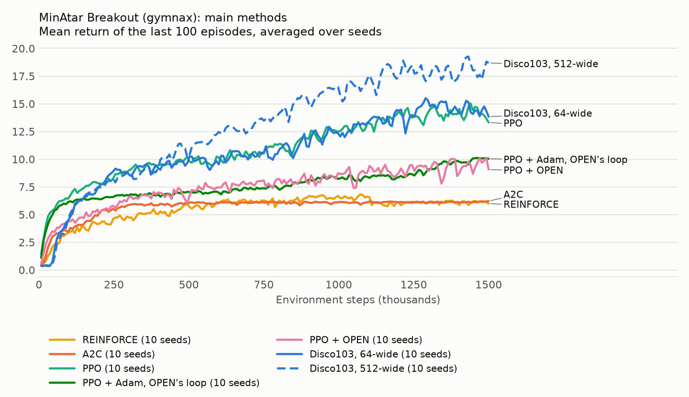

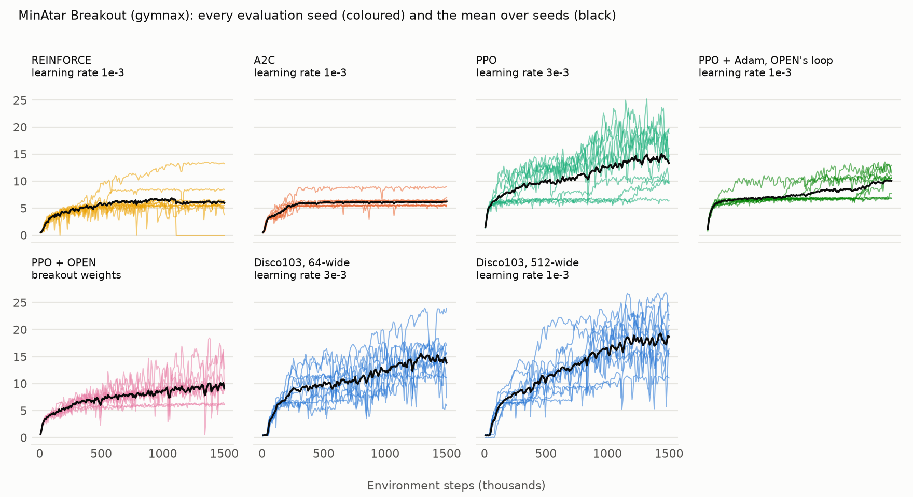

### Evaluation: Disco103 at replay ratio 4

| Method | Setting | Seeds | Final return, mean (min..max) | Each seed |
|---|---|---|---|---|
| Disco103, 512-wide, replay ratio 4 | learning rate 3e-3 | 10 | 7.0 (5.2..10.0) | 8.1, 7.6, 7.3, 6.0, 6.5, 6.5, 5.2, 10.0, 6.4, 6.9 |
| Disco103, 64-wide, replay ratio 4 | learning rate 1e-2 | 10 | 6.6 (1.9..13.5) | 13.5, 7.4, 6.2, 2.8, 6.7, 6.1, 9.3, 1.9, 6.9, 5.1 |

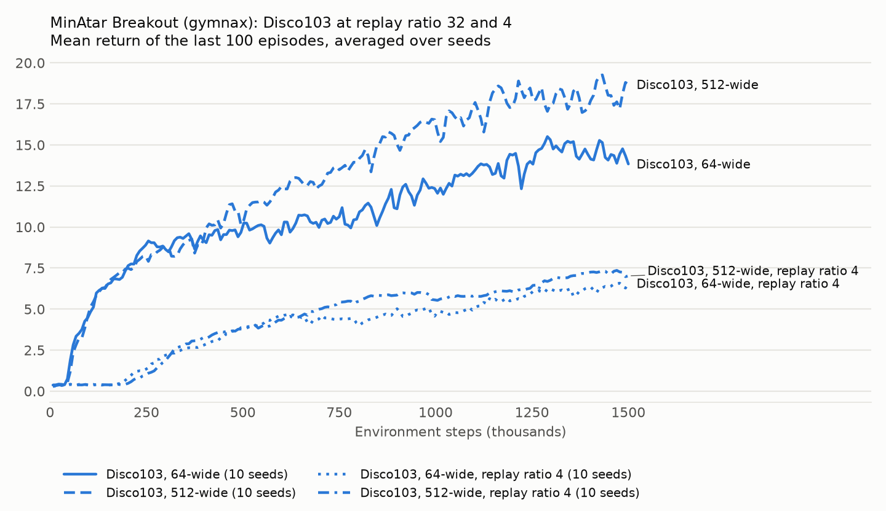

### Evaluation: baselines with 512×512 networks

| Method | Setting | Seeds | Final return, mean (min..max) | Each seed |
|---|---|---|---|---|
| PPO, 512-wide | learning rate 1e-3 | 10 | 15.0 (13.1..18.1) | 18.1, 13.3, 17.4, 13.5, 14.6, 15.6, 14.5, 13.1, 13.8, 16.0 |
| A2C, 512-wide | learning rate 3e-4 | 10 | 5.5 (1.5..8.7) | 5.4, 5.5, 6.8, 1.5, 6.0, 1.5, 8.5, 5.5, 5.5, 8.7 |
| REINFORCE, 512-wide | learning rate 1e-4 | 10 | 5.3 (4.1..5.8) | 5.4, 5.6, 5.2, 5.2, 5.8, 5.7, 4.1, 5.5, 5.1, 5.5 |

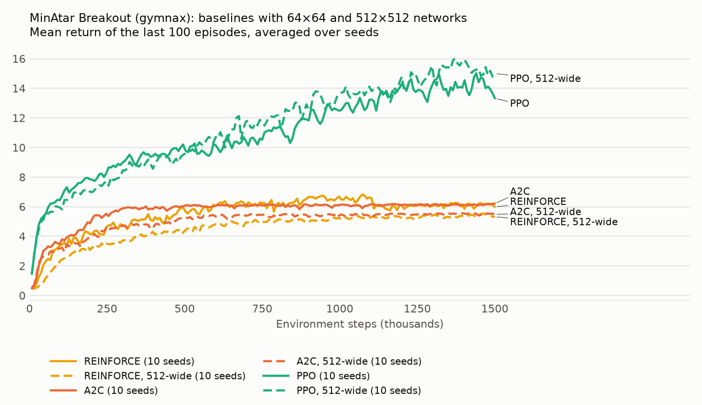

### Search

Final return of every search run.

| Method | Setting | Seed 0 | Seed 1 | Seed 2 | Mean |
|---|---|---|---|---|---|
| REINFORCE | learning rate 3e-4 | 5.3 | 5.0 | 5.2 | 5.1 |
| REINFORCE | learning rate 1e-3 (chosen) | 5.5 | 5.9 | 5.3 | 5.6 |
| REINFORCE | learning rate 3e-3 | 0.0 | 2.8 | 0.0 | 0.9 |
| REINFORCE | learning rate 1e-2 | 0.5 | 1.5 | 0.0 | 0.7 |
| A2C | learning rate 1e-4 | 5.5 | 5.7 | 5.7 | 5.6 |
| A2C | learning rate 3e-4 | 5.4 | 5.9 | 5.6 | 5.6 |
| A2C | learning rate 1e-3 (chosen) | 0.5 | 8.3 | 8.9 | 5.9 |
| A2C | learning rate 3e-3 | 0.0 | 0.4 | 5.5 | 2.0 |
| PPO | learning rate 3e-4 | 11.4 | 6.9 | 6.5 | 8.3 |
| PPO | learning rate 1e-3 | 6.7 | 14.1 | 12.3 | 11.0 |
| PPO | learning rate 3e-3 (chosen) | 6.8 | 16.5 | 15.0 | 12.8 |
| PPO | learning rate 1e-2 | 6.6 | 1.6 | 5.3 | 4.5 |
| PPO + Adam, OPEN's loop | learning rate 1e-4 | 6.4 | 6.5 | 6.0 | 6.3 |
| PPO + Adam, OPEN's loop | learning rate 3e-4 | 6.4 | 6.6 | 6.2 | 6.4 |
| PPO + Adam, OPEN's loop | learning rate 1e-3 (chosen) | 14.8 | 12.8 | 10.9 | 12.8 |
| PPO + Adam, OPEN's loop | learning rate 3e-3 | 18.3 | 9.7 | 6.8 | 11.6 |
| PPO + OPEN | gridworld weights | 7.0 | 10.8 | 7.0 | 8.2 |
| PPO + OPEN | multi weights | 6.3 | 12.0 | 8.8 | 9.0 |
| PPO + OPEN | breakout weights (chosen) | 13.4 | 10.4 | 6.8 | 10.2 |
| Disco103, 64-wide | learning rate 1e-3 | 10.4 | 6.6 | 7.4 | 8.1 |
| Disco103, 64-wide | learning rate 3e-3 (chosen) | 10.8 | 8.3 | 17.0 | 12.0 |
| Disco103, 64-wide | learning rate 1e-2 | 6.7 | 7.6 | 13.3 | 9.2 |
| Disco103, 512-wide | learning rate 3e-4 | 6.4 | 10.2 | 9.0 | 8.6 |
| Disco103, 512-wide | learning rate 1e-3 (chosen) | 20.7 | 23.7 | 23.9 | 22.8 |
| Disco103, 512-wide | learning rate 3e-3 | 18.5 | 13.1 | 19.9 | 17.2 |
| Disco103, 512-wide | learning rate 1e-2 | 0.5 | 6.0 | 0.4 | 2.3 |
| REINFORCE, 512-wide | learning rate 3e-5 | 4.6 | 4.3 | 4.3 | 4.4 |
| REINFORCE, 512-wide | learning rate 1e-4 (chosen) | 5.4 | 5.5 | 5.3 | 5.4 |
| REINFORCE, 512-wide | learning rate 3e-4 | 3.1 | 5.7 | 5.5 | 4.7 |
| REINFORCE, 512-wide | learning rate 1e-3 | 0.0 | 0.0 | 0.0 | 0.0 |
| REINFORCE, 512-wide | learning rate 3e-3 | 0.5 | 0.5 | 0.0 | 0.4 |
| A2C, 512-wide | learning rate 1e-4 | 5.6 | 5.8 | 5.5 | 5.6 |
| A2C, 512-wide | learning rate 3e-4 (chosen) | 9.0 | 5.5 | 5.5 | 6.7 |
| A2C, 512-wide | learning rate 1e-3 | 0.5 | 0.0 | 0.0 | 0.2 |
| PPO, 512-wide | learning rate 1e-4 | 8.8 | 5.5 | 5.5 | 6.6 |
| PPO, 512-wide | learning rate 3e-4 | 6.9 | 14.1 | 15.7 | 12.2 |
| PPO, 512-wide | learning rate 1e-3 (chosen) | 11.8 | 14.3 | 19.1 | 15.0 |
| PPO, 512-wide | learning rate 3e-3 | 0.0 | 6.7 | 5.5 | 4.1 |
| Disco103, 64-wide, replay ratio 4 | learning rate 1e-3 | 4.4 | 4.5 | 4.7 | 4.5 |
| Disco103, 64-wide, replay ratio 4 | learning rate 3e-3 | 5.5 | 6.8 | 6.4 | 6.2 |
| Disco103, 64-wide, replay ratio 4 | learning rate 1e-2 (chosen) | 8.8 | 6.5 | 6.2 | 7.2 |
| Disco103, 64-wide, replay ratio 4 | learning rate 3e-2 | 0.3 | 0.4 | 0.5 | 0.4 |
| Disco103, 512-wide, replay ratio 4 | learning rate 1e-3 | 7.0 | 6.5 | 5.0 | 6.2 |
| Disco103, 512-wide, replay ratio 4 | learning rate 3e-3 (chosen) | 8.2 | 9.8 | 6.4 | 8.1 |
| Disco103, 512-wide, replay ratio 4 | learning rate 1e-2 | 0.5 | 4.6 | 0.6 | 1.9 |
| Disco103, 512-wide, replay ratio 4 | learning rate 3e-2 | 0.4 | 0.4 | 0.4 | 0.4 |

## MinAtar Space Invaders (gymnax)

1,500,000 environment steps per run, 16 environments.

### Evaluation: main methods

| Method | Setting | Seeds | Final return, mean (min..max) | Each seed |
|---|---|---|---|---|
| Disco103, 512-wide | learning rate 1e-4 | 10 | 92.1 (56.3..115.3) | 56.3, 82.8, 115.3, 88.8, 103.5, 76.1, 99.2, 103.5, 99.0, 96.4 |
| PPO + OPEN | spaceinvaders weights | 10 | 74.9 (56.2..88.5) | 88.0, 62.1, 72.6, 69.5, 84.7, 84.2, 88.5, 72.3, 56.2, 71.4 |
| PPO + Adam, OPEN's loop | learning rate 1e-3 | 10 | 62.7 (31.0..79.5) | 73.6, 31.0, 65.3, 79.5, 47.2, 46.8, 62.9, 69.4, 74.5, 76.7 |
| PPO | learning rate 3e-4 | 10 | 59.5 (50.4..68.7) | 66.3, 50.4, 52.7, 62.2, 59.8, 61.7, 54.7, 68.7, 62.0, 56.9 |
| Disco103, 64-wide | learning rate 3e-3 | 10 | 48.6 (28.1..85.6) | 63.0, 29.3, 28.1, 42.8, 41.4, 52.5, 85.6, 42.8, 29.8, 71.2 |
| A2C | learning rate 1e-3 | 10 | 42.1 (27.6..74.6) | 34.5, 74.6, 29.8, 44.9, 27.6, 43.2, 30.8, 53.2, 47.5, 35.0 |
| REINFORCE | learning rate 3e-3 | 10 | 19.1 (9.0..23.6) | 20.6, 20.3, 23.6, 14.0, 21.0, 22.5, 9.0, 20.0, 20.2, 19.8 |

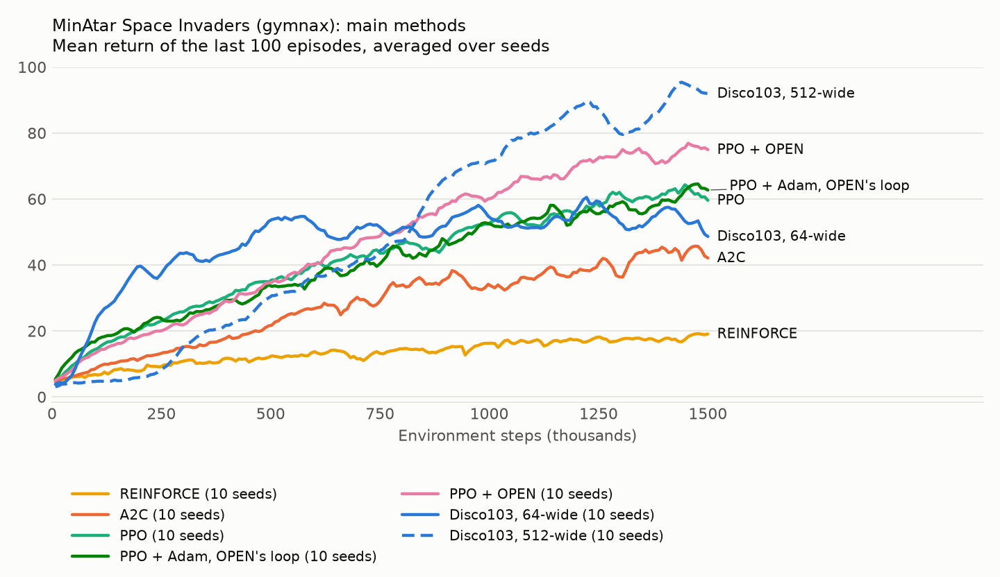

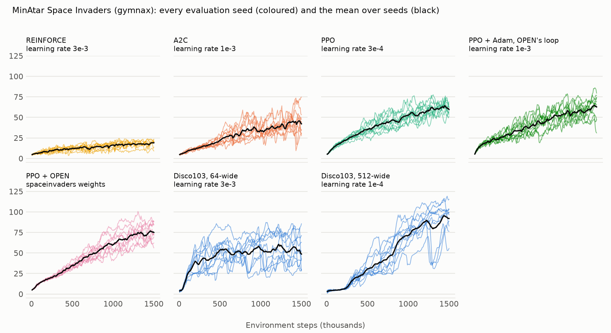

### Evaluation: Disco103 at replay ratio 4

| Method | Setting | Seeds | Final return, mean (min..max) | Each seed |
|---|---|---|---|---|
| Disco103, 512-wide, replay ratio 4 | learning rate 3e-3 | 10 | 81.5 (43.2..101.5) | 87.2, 86.7, 93.9, 46.9, 86.5, 101.5, 92.1, 89.8, 43.2, 87.2 |
| Disco103, 64-wide, replay ratio 4 | learning rate 3e-3 | 10 | 63.1 (28.0..105.8) | 48.6, 105.8, 45.1, 56.7, 61.8, 74.3, 45.5, 28.0, 62.2, 102.5 |

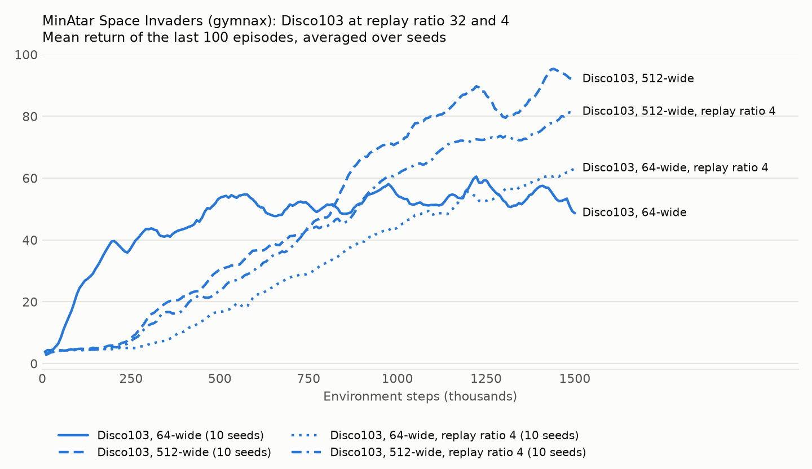

### Evaluation: baselines with 512×512 networks

| Method | Setting | Seeds | Final return, mean (min..max) | Each seed |
|---|---|---|---|---|
| PPO, 512-wide | learning rate 1e-4 | 10 | 67.2 (56.3..85.0) | 73.4, 67.5, 70.2, 57.4, 85.0, 66.2, 72.1, 56.3, 63.4, 60.6 |
| A2C, 512-wide | learning rate 3e-4 | 10 | 40.2 (5.0..71.8) | 43.1, 66.8, 42.7, 71.8, 37.0, 23.4, 46.5, 38.0, 5.0, 27.3 |
| REINFORCE, 512-wide | learning rate 3e-4 | 10 | 21.5 (16.1..28.1) | 18.1, 22.8, 28.1, 16.1, 23.9, 21.5, 19.6, 20.2, 21.5, 23.7 |

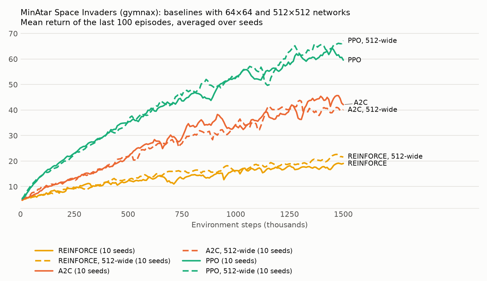

### Search

Final return of every search run.

| Method | Setting | Seed 0 | Seed 1 | Seed 2 | Mean |
|---|---|---|---|---|---|
| REINFORCE | learning rate 1e-3 | 14.5 | 20.1 | 21.9 | 18.8 |
| REINFORCE | learning rate 3e-3 (chosen) | 21.6 | 19.8 | 21.4 | 20.9 |
| REINFORCE | learning rate 1e-2 | 6.1 | 3.0 | 3.0 | 4.0 |
| A2C | learning rate 1e-4 | 18.3 | 17.4 | 17.4 | 17.7 |
| A2C | learning rate 3e-4 | 44.1 | 45.7 | 41.5 | 43.8 |
| A2C | learning rate 1e-3 (chosen) | 37.8 | 57.8 | 55.8 | 50.5 |
| A2C | learning rate 3e-3 | 7.7 | 26.1 | 23.0 | 18.9 |
| PPO | learning rate 1e-4 | 52.1 | 53.0 | 60.5 | 55.2 |
| PPO | learning rate 3e-4 (chosen) | 59.4 | 70.9 | 70.7 | 67.0 |
| PPO | learning rate 1e-3 | 52.0 | 54.3 | 58.0 | 54.8 |
| PPO | learning rate 3e-3 | 29.9 | 35.5 | 42.4 | 35.9 |
| PPO + Adam, OPEN's loop | learning rate 1e-4 | 45.1 | 52.2 | 63.5 | 53.6 |
| PPO + Adam, OPEN's loop | learning rate 3e-4 | 58.0 | 51.0 | 61.5 | 56.9 |
| PPO + Adam, OPEN's loop | learning rate 1e-3 (chosen) | 83.4 | 66.3 | 79.9 | 76.6 |
| PPO + Adam, OPEN's loop | learning rate 3e-3 | 31.2 | 62.1 | 56.1 | 49.8 |
| PPO + OPEN | gridworld weights | 27.1 | 49.4 | 35.3 | 37.3 |
| PPO + OPEN | multi weights | 33.0 | 27.1 | 22.9 | 27.7 |
| PPO + OPEN | spaceinvaders weights (chosen) | 72.7 | 67.2 | 56.6 | 65.5 |
| Disco103, 64-wide | learning rate 1e-3 | 78.8 | 26.0 | 72.5 | 59.1 |
| Disco103, 64-wide | learning rate 3e-3 (chosen) | 87.2 | 60.2 | 71.9 | 73.1 |
| Disco103, 64-wide | learning rate 1e-2 | 37.4 | 38.7 | 28.6 | 34.9 |
| Disco103, 512-wide | learning rate 1e-4 (chosen) | 81.5 | 107.7 | 53.5 | 80.9 |
| Disco103, 512-wide | learning rate 3e-4 | 67.7 | 72.6 | 91.9 | 77.4 |
| Disco103, 512-wide | learning rate 1e-3 | 43.1 | 63.0 | 86.1 | 64.1 |
| Disco103, 512-wide | learning rate 3e-3 | 52.3 | 69.8 | 65.6 | 62.6 |
| Disco103, 512-wide | learning rate 1e-2 | 17.3 | 5.4 | 15.7 | 12.8 |
| REINFORCE, 512-wide | learning rate 1e-4 | 14.8 | 15.9 | 14.5 | 15.1 |
| REINFORCE, 512-wide | learning rate 3e-4 (chosen) | 19.0 | 19.0 | 17.8 | 18.6 |
| REINFORCE, 512-wide | learning rate 1e-3 | 15.0 | 25.5 | 9.2 | 16.6 |
| REINFORCE, 512-wide | learning rate 3e-3 | 3.0 | 3.0 | 3.0 | 3.0 |
| A2C, 512-wide | learning rate 1e-4 | 30.4 | 44.2 | 31.3 | 35.3 |
| A2C, 512-wide | learning rate 3e-4 (chosen) | 24.5 | 72.5 | 29.3 | 42.1 |
| A2C, 512-wide | learning rate 1e-3 | 3.0 | 3.0 | 3.0 | 3.0 |
| PPO, 512-wide | learning rate 3e-5 | 59.8 | 44.1 | 52.9 | 52.3 |
| PPO, 512-wide | learning rate 1e-4 (chosen) | 77.3 | 84.1 | 72.2 | 77.8 |
| PPO, 512-wide | learning rate 3e-4 | 68.4 | 82.5 | 52.5 | 67.8 |
| PPO, 512-wide | learning rate 1e-3 | 27.0 | 32.3 | 51.7 | 37.0 |
| PPO, 512-wide | learning rate 3e-3 | 0.0 | 3.0 | 3.0 | 2.0 |
| Disco103, 64-wide, replay ratio 4 | learning rate 1e-3 | 28.1 | 30.3 | 54.0 | 37.5 |
| Disco103, 64-wide, replay ratio 4 | learning rate 3e-3 (chosen) | 77.2 | 76.7 | 21.4 | 58.4 |
| Disco103, 64-wide, replay ratio 4 | learning rate 1e-2 | 10.2 | 25.8 | 73.8 | 36.6 |
| Disco103, 64-wide, replay ratio 4 | learning rate 3e-2 | 5.3 | 4.3 | 4.8 | 4.8 |
| Disco103, 512-wide, replay ratio 4 | learning rate 1e-3 | 72.8 | 50.0 | 84.6 | 69.1 |
| Disco103, 512-wide, replay ratio 4 | learning rate 3e-3 (chosen) | 75.7 | 67.5 | 91.7 | 78.3 |
| Disco103, 512-wide, replay ratio 4 | learning rate 1e-2 | 10.9 | 11.9 | 6.7 | 9.8 |
| Disco103, 512-wide, replay ratio 4 | learning rate 3e-2 | 5.2 | 5.4 | 4.0 | 4.9 |

## MinAtar Asterix (gymnax)

1,500,000 environment steps per run, 16 environments.

### Evaluation: main methods

| Method | Setting | Seeds | Final return, mean (min..max) | Each seed |
|---|---|---|---|---|
| PPO | learning rate 1e-3 | 10 | 1.9 (1.2..2.9) | 2.4, 1.9, 1.8, 1.6, 2.9, 1.2, 1.7, 2.0, 2.1, 1.4 |
| PPO + Adam, OPEN's loop | learning rate 3e-4 | 10 | 1.7 (1.5..2.2) | 1.7, 1.5, 2.1, 1.6, 1.6, 1.9, 1.5, 1.5, 1.5, 2.2 |
| A2C | learning rate 1e-3 | 10 | 1.4 (0.9..1.7) | 1.7, 1.4, 1.4, 1.5, 1.4, 1.4, 1.5, 1.5, 1.2, 0.9 |
| PPO + OPEN | multi weights | 10 | 1.1 (0.7..1.4) | 1.2, 1.3, 1.0, 1.1, 1.0, 1.4, 1.3, 1.0, 1.1, 0.7 |
| REINFORCE | learning rate 3e-4 | 10 | 0.9 (0.7..1.0) | 0.8, 1.0, 0.8, 0.8, 0.7, 0.8, 0.9, 1.0, 0.9, 1.0 |
| Disco103, 512-wide | learning rate 3e-3 | 10 | 0.8 (0.6..0.9) | 0.8, 0.8, 0.6, 0.9, 0.8, 0.8, 0.8, 0.9, 0.8, 0.6 |
| Disco103, 64-wide | learning rate 3e-4 | 10 | 0.7 (0.5..0.9) | 0.9, 0.6, 0.5, 0.6, 0.8, 0.5, 0.6, 0.9, 0.9, 0.5 |

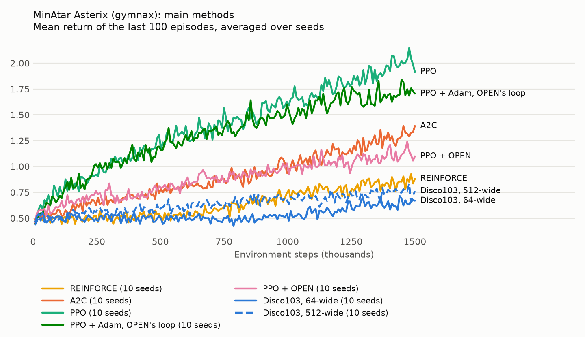

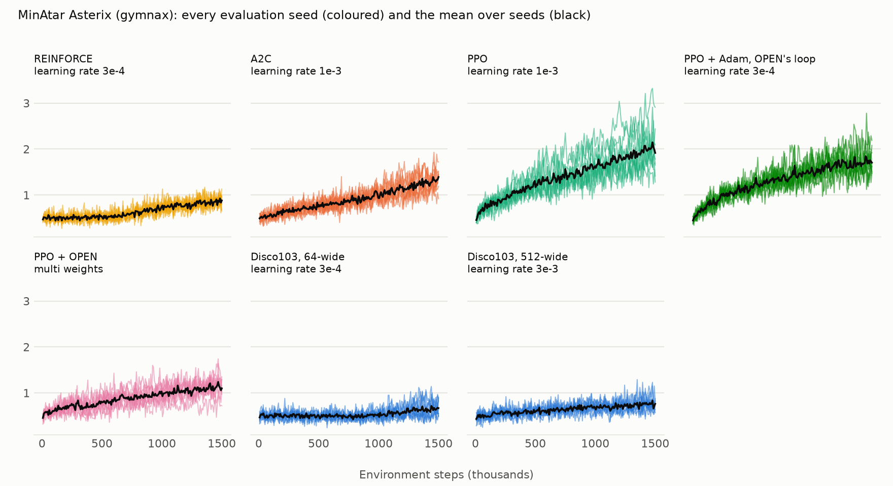

### Evaluation: Disco103 at replay ratio 4

| Method | Setting | Seeds | Final return, mean (min..max) | Each seed |
|---|---|---|---|---|
| Disco103, 64-wide, replay ratio 4 | learning rate 3e-3 | 10 | 0.5 (0.4..0.6) | 0.4, 0.6, 0.5, 0.6, 0.5, 0.6, 0.4, 0.6, 0.4, 0.5 |
| Disco103, 512-wide, replay ratio 4 | learning rate 3e-2 | 10 | 0.5 (0.3..0.7) | 0.4, 0.6, 0.3, 0.7, 0.5, 0.5, 0.5, 0.4, 0.5, 0.5 |

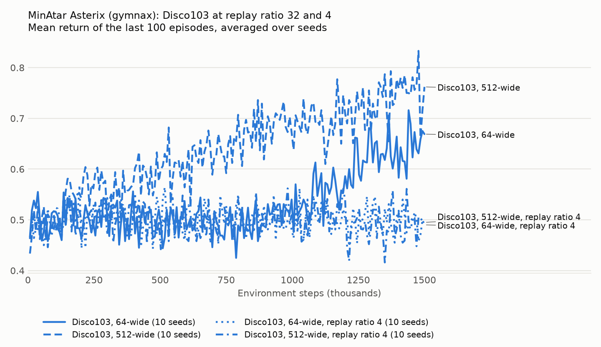

### Evaluation: baselines with 512×512 networks

| Method | Setting | Seeds | Final return, mean (min..max) | Each seed |
|---|---|---|---|---|
| PPO, 512-wide | learning rate 3e-4 | 10 | 1.9 (1.4..2.8) | 1.8, 1.6, 1.6, 2.8, 2.0, 1.6, 2.0, 1.7, 2.2, 1.4 |
| REINFORCE, 512-wide | learning rate 3e-4 | 10 | 1.0 (0.8..1.2) | 1.2, 1.0, 1.0, 0.9, 1.0, 0.8, 0.8, 0.9, 1.2, 0.9 |
| A2C, 512-wide | learning rate 1e-3 | 10 | 0.9 (0.6..1.3) | 0.8, 0.9, 0.8, 0.8, 0.8, 0.6, 1.1, 1.3, 0.8, 0.9 |

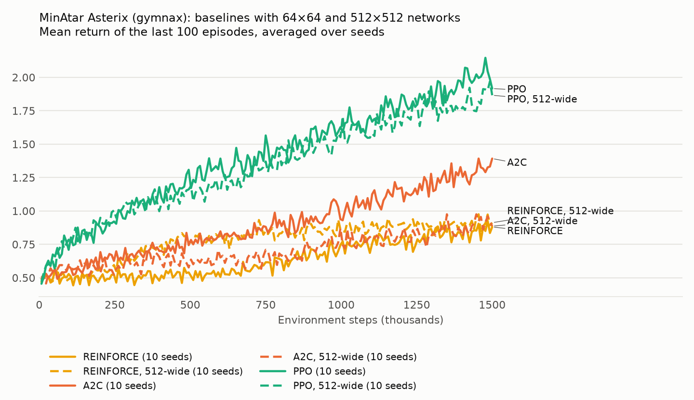

### Search

Final return of every search run.

| Method | Setting | Seed 0 | Seed 1 | Seed 2 | Mean |
|---|---|---|---|---|---|
| REINFORCE | learning rate 1e-4 | 0.5 | 0.6 | 0.4 | 0.5 |
| REINFORCE | learning rate 3e-4 (chosen) | 0.7 | 1.0 | 0.9 | 0.9 |
| REINFORCE | learning rate 1e-3 | 1.0 | 0.8 | 0.9 | 0.9 |
| REINFORCE | learning rate 3e-3 | 1.0 | 0.6 | 1.0 | 0.8 |
| REINFORCE | learning rate 1e-2 | 0.5 | 0.6 | 0.5 | 0.5 |
| A2C | learning rate 1e-4 | 0.8 | 0.6 | 0.5 | 0.6 |
| A2C | learning rate 3e-4 | 1.4 | 1.4 | 1.1 | 1.3 |
| A2C | learning rate 1e-3 (chosen) | 1.2 | 1.5 | 1.4 | 1.4 |
| A2C | learning rate 3e-3 | 1.0 | 1.2 | 1.0 | 1.1 |
| PPO | learning rate 3e-4 | 1.5 | 1.6 | 3.2 | 2.1 |
| PPO | learning rate 1e-3 (chosen) | 2.5 | 2.1 | 1.8 | 2.1 |
| PPO | learning rate 3e-3 | 1.1 | 1.2 | 1.3 | 1.2 |
| PPO + Adam, OPEN's loop | learning rate 1e-4 | 1.6 | 1.5 | 2.1 | 1.7 |
| PPO + Adam, OPEN's loop | learning rate 3e-4 (chosen) | 2.2 | 1.7 | 1.9 | 1.9 |
| PPO + Adam, OPEN's loop | learning rate 1e-3 | 1.5 | 1.6 | 1.6 | 1.6 |
| PPO + Adam, OPEN's loop | learning rate 3e-3 | 1.1 | 1.4 | 1.1 | 1.2 |
| PPO + OPEN | gridworld weights | 1.3 | 1.0 | 1.0 | 1.1 |
| PPO + OPEN | multi weights (chosen) | 1.1 | 1.1 | 1.1 | 1.1 |
| PPO + OPEN | asterix weights | 0.4 | 0.6 | 0.4 | 0.4 |
| Disco103, 64-wide | learning rate 1e-4 | 0.4 | 0.5 | 0.5 | 0.5 |
| Disco103, 64-wide | learning rate 3e-4 (chosen) | 0.9 | 1.0 | 0.8 | 0.9 |
| Disco103, 64-wide | learning rate 1e-3 | 0.6 | 0.7 | 0.7 | 0.7 |
| Disco103, 64-wide | learning rate 3e-3 | 0.5 | 0.7 | 0.6 | 0.6 |
| Disco103, 64-wide | learning rate 1e-2 | 0.5 | 0.5 | 0.5 | 0.5 |
| Disco103, 512-wide | learning rate 1e-3 | 0.9 | 0.7 | 0.8 | 0.8 |
| Disco103, 512-wide | learning rate 3e-3 (chosen) | 0.8 | 0.7 | 0.9 | 0.8 |
| Disco103, 512-wide | learning rate 1e-2 | 0.5 | 0.5 | 0.5 | 0.5 |
| REINFORCE, 512-wide | learning rate 1e-4 | 0.7 | 1.0 | 1.0 | 0.9 |
| REINFORCE, 512-wide | learning rate 3e-4 (chosen) | 1.1 | 0.9 | 0.9 | 1.0 |
| REINFORCE, 512-wide | learning rate 1e-3 | 0.9 | 1.0 | 0.7 | 0.9 |
| REINFORCE, 512-wide | learning rate 3e-3 | 0.4 | 0.5 | 0.6 | 0.5 |
| A2C, 512-wide | learning rate 1e-4 | 1.0 | 1.2 | 0.9 | 1.0 |
| A2C, 512-wide | learning rate 3e-4 | 1.1 | 1.0 | 0.9 | 1.0 |
| A2C, 512-wide | learning rate 1e-3 (chosen) | 1.1 | 1.2 | 0.9 | 1.1 |
| A2C, 512-wide | learning rate 3e-3 | 0.8 | 0.5 | 0.5 | 0.6 |
| PPO, 512-wide | learning rate 1e-4 | 1.7 | 2.3 | 1.3 | 1.8 |
| PPO, 512-wide | learning rate 3e-4 (chosen) | 1.8 | 2.5 | 1.5 | 1.9 |
| PPO, 512-wide | learning rate 1e-3 | 0.8 | 0.9 | 0.9 | 0.9 |
| PPO, 512-wide | learning rate 3e-3 | 0.4 | 0.6 | 0.3 | 0.4 |
| Disco103, 64-wide, replay ratio 4 | learning rate 1e-3 | 0.5 | 0.4 | 0.4 | 0.5 |
| Disco103, 64-wide, replay ratio 4 | learning rate 3e-3 (chosen) | 0.5 | 0.5 | 0.5 | 0.5 |
| Disco103, 64-wide, replay ratio 4 | learning rate 1e-2 | 0.5 | 0.4 | 0.5 | 0.5 |
| Disco103, 64-wide, replay ratio 4 | learning rate 3e-2 | 0.5 | 0.6 | 0.4 | 0.5 |
| Disco103, 512-wide, replay ratio 4 | learning rate 1e-3 | 0.5 | 0.4 | 0.5 | 0.5 |
| Disco103, 512-wide, replay ratio 4 | learning rate 3e-3 | 0.7 | 0.5 | 0.5 | 0.6 |
| Disco103, 512-wide, replay ratio 4 | learning rate 1e-2 | 0.5 | 0.5 | 0.5 | 0.5 |
| Disco103, 512-wide, replay ratio 4 | learning rate 3e-2 (chosen) | 0.6 | 0.6 | 0.7 | 0.6 |
| Disco103, 512-wide, replay ratio 4 | learning rate 1e-1 | 0.7 | 0.5 | 0.5 | 0.5 |

## MinAtar Freeway (gymnax)

1,500,000 environment steps per run, 16 environments.

### Evaluation: main methods

| Method | Setting | Seeds | Final return, mean (min..max) | Each seed |
|---|---|---|---|---|
| A2C | learning rate 3e-3 | 10 | 33.4 (31.6..36.3) | 34.2, 34.1, 32.0, 36.3, 34.4, 32.8, 31.9, 32.0, 34.5, 31.6 |
| PPO + OPEN | multi weights | 10 | 33.1 (26.4..38.6) | 33.4, 34.6, 32.8, 38.6, 34.9, 34.4, 34.6, 31.9, 26.4, 29.7 |
| PPO + Adam, OPEN's loop | learning rate 3e-4 | 10 | 31.4 (27.9..35.2) | 32.0, 33.0, 29.4, 27.9, 33.6, 29.4, 35.2, 31.6, 29.2, 33.1 |
| PPO | learning rate 3e-4 | 10 | 31.2 (28.8..33.2) | 32.5, 28.8, 32.2, 31.1, 31.1, 30.1, 31.3, 30.7, 31.2, 33.2 |
| REINFORCE | learning rate 1e-3 | 10 | 24.1 (22.4..25.8) | 24.9, 24.9, 24.1, 25.8, 22.4, 23.0, 22.9, 24.8, 24.4, 23.8 |
| Disco103, 512-wide | learning rate 1e-3 | 10 | 22.6 (19.1..26.3) | 26.3, 23.8, 23.3, 22.8, 23.1, 19.1, 20.6, 21.2, 24.0, 22.0 |
| Disco103, 64-wide | learning rate 1e-3 | 10 | 20.6 (15.7..29.1) | 18.4, 20.4, 29.1, 18.0, 18.6, 15.7, 22.1, 20.2, 23.7, 19.7 |

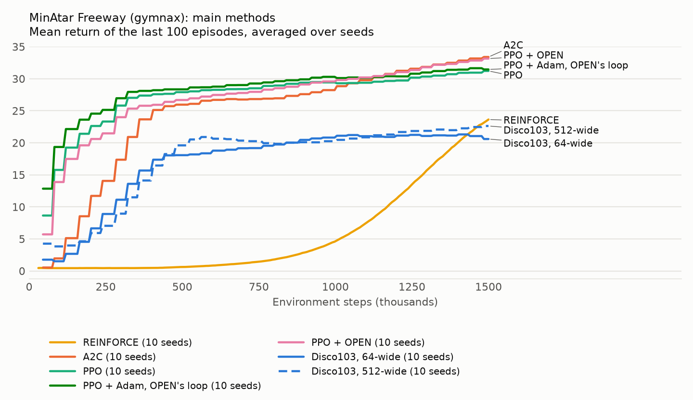

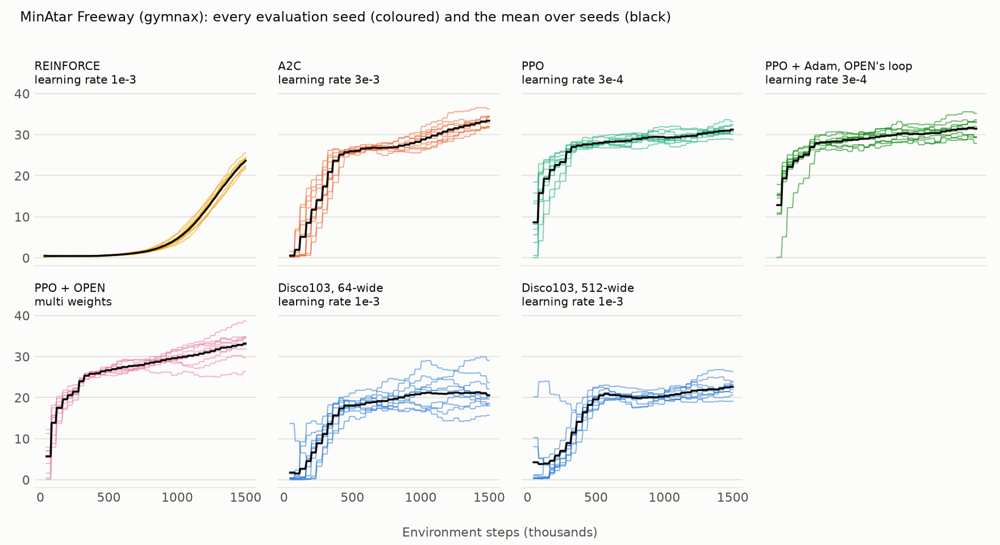

### Evaluation: Disco103 at replay ratio 4

| Method | Setting | Seeds | Final return, mean (min..max) | Each seed |
|---|---|---|---|---|
| Disco103, 64-wide, replay ratio 4 | learning rate 3e-3 | 10 | 22.0 (17.5..28.2) | 23.2, 18.1, 20.8, 19.7, 23.3, 17.5, 17.8, 28.2, 25.7, 25.5 |
| Disco103, 512-wide, replay ratio 4 | learning rate 3e-3 | 10 | 21.8 (14.0..26.5) | 14.0, 17.4, 23.9, 23.6, 23.0, 26.1, 20.4, 21.4, 21.8, 26.5 |

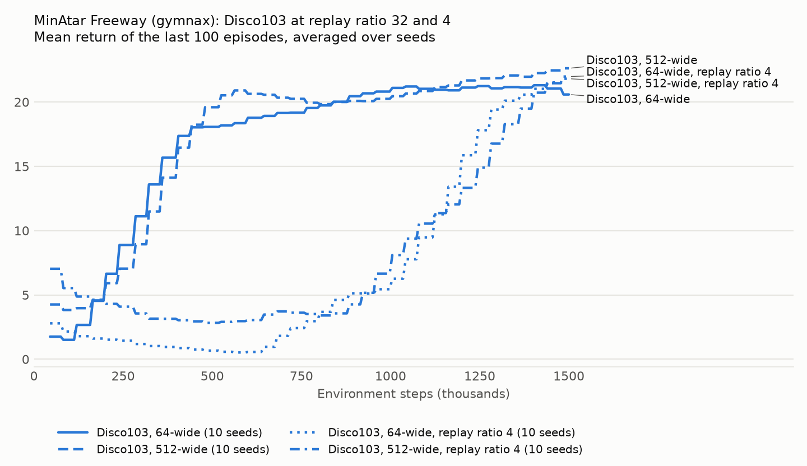

### Evaluation: baselines with 512×512 networks

| Method | Setting | Seeds | Final return, mean (min..max) | Each seed |
|---|---|---|---|---|
| PPO, 512-wide | learning rate 1e-4 | 10 | 32.5 (29.8..34.8) | 31.8, 31.7, 31.4, 33.7, 32.8, 34.8, 32.2, 33.5, 29.8, 33.8 |
| A2C, 512-wide | learning rate 1e-3 | 10 | 31.9 (28.4..34.8) | 29.9, 32.4, 31.7, 33.5, 32.2, 34.8, 28.4, 33.8, 30.5, 32.3 |
| REINFORCE, 512-wide | learning rate 3e-4 | 10 | 27.0 (25.9..28.2) | 27.4, 25.9, 27.7, 26.3, 25.9, 28.0, 26.0, 28.1, 26.4, 28.2 |

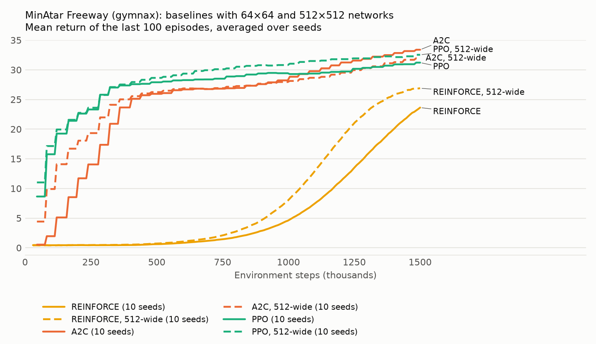

### Search

Final return of every search run.

| Method | Setting | Seed 0 | Seed 1 | Seed 2 | Mean |
|---|---|---|---|---|---|
| REINFORCE | learning rate 3e-4 | 0.9 | 0.7 | 0.9 | 0.8 |
| REINFORCE | learning rate 1e-3 (chosen) | 24.6 | 23.9 | 23.6 | 24.1 |
| REINFORCE | learning rate 3e-3 | 21.8 | 21.1 | 21.0 | 21.3 |
| REINFORCE | learning rate 1e-2 | 21.5 | 15.9 | 18.7 | 18.7 |
| A2C | learning rate 1e-4 | 24.1 | 25.4 | 24.6 | 24.7 |
| A2C | learning rate 3e-4 | 26.1 | 26.6 | 24.9 | 25.8 |
| A2C | learning rate 1e-3 | 31.6 | 32.7 | 34.3 | 32.9 |
| A2C | learning rate 3e-3 (chosen) | 34.9 | 35.5 | 31.8 | 34.1 |
| A2C | learning rate 1e-2 | 16.7 | 15.2 | 16.2 | 16.0 |
| PPO | learning rate 1e-4 | 30.0 | 31.2 | 25.8 | 29.0 |
| PPO | learning rate 3e-4 (chosen) | 29.4 | 29.6 | 31.2 | 30.1 |
| PPO | learning rate 1e-3 | 29.8 | 28.9 | 27.9 | 28.9 |
| PPO | learning rate 3e-3 | 20.5 | 22.6 | 21.1 | 21.4 |
| PPO + Adam, OPEN's loop | learning rate 1e-4 | 26.0 | 31.1 | 28.9 | 28.7 |
| PPO + Adam, OPEN's loop | learning rate 3e-4 (chosen) | 30.5 | 34.2 | 32.6 | 32.5 |
| PPO + Adam, OPEN's loop | learning rate 1e-3 | 32.5 | 30.7 | 30.2 | 31.1 |
| PPO + Adam, OPEN's loop | learning rate 3e-3 | 22.2 | 23.6 | 22.7 | 22.8 |
| PPO + OPEN | gridworld weights | 28.8 | 28.6 | 28.6 | 28.6 |
| PPO + OPEN | multi weights (chosen) | 33.6 | 33.3 | 34.0 | 33.6 |
| PPO + OPEN | freeway weights | 32.3 | 29.1 | 29.4 | 30.2 |
| Disco103, 64-wide | learning rate 3e-4 | 21.7 | 21.3 | 14.1 | 19.0 |
| Disco103, 64-wide | learning rate 1e-3 (chosen) | 18.9 | 27.6 | 19.3 | 21.9 |
| Disco103, 64-wide | learning rate 3e-3 | 21.3 | 21.0 | 21.0 | 21.1 |
| Disco103, 64-wide | learning rate 1e-2 | 22.8 | 0.6 | 22.9 | 15.4 |
| Disco103, 512-wide | learning rate 3e-4 | 21.7 | 23.3 | 16.9 | 20.6 |
| Disco103, 512-wide | learning rate 1e-3 (chosen) | 20.4 | 21.4 | 22.4 | 21.4 |
| Disco103, 512-wide | learning rate 3e-3 | 20.5 | 18.9 | 20.0 | 19.8 |
| Disco103, 512-wide | learning rate 1e-2 | 0.5 | 0.6 | 0.5 | 0.5 |
| REINFORCE, 512-wide | learning rate 1e-4 | 1.4 | 1.2 | 1.5 | 1.3 |
| REINFORCE, 512-wide | learning rate 3e-4 (chosen) | 27.2 | 27.9 | 26.7 | 27.3 |
| REINFORCE, 512-wide | learning rate 1e-3 | 26.8 | 28.1 | 17.7 | 24.2 |
| REINFORCE, 512-wide | learning rate 3e-3 | 16.3 | 16.3 | 25.7 | 19.4 |
| A2C, 512-wide | learning rate 1e-4 | 27.6 | 25.9 | 26.7 | 26.7 |
| A2C, 512-wide | learning rate 3e-4 | 28.0 | 26.8 | 27.1 | 27.3 |
| A2C, 512-wide | learning rate 1e-3 (chosen) | 33.1 | 30.6 | 32.6 | 32.1 |
| A2C, 512-wide | learning rate 3e-3 | 20.4 | 16.7 | 16.2 | 17.8 |
| PPO, 512-wide | learning rate 3e-5 | 30.9 | 31.5 | 32.2 | 31.6 |
| PPO, 512-wide | learning rate 1e-4 (chosen) | 34.7 | 31.3 | 32.7 | 32.9 |
| PPO, 512-wide | learning rate 3e-4 | 28.1 | 28.5 | 27.7 | 28.1 |
| PPO, 512-wide | learning rate 1e-3 | 13.3 | 18.9 | 11.6 | 14.6 |
| PPO, 512-wide | learning rate 3e-3 | 19.9 | 18.4 | 19.5 | 19.3 |
| Disco103, 64-wide, replay ratio 4 | learning rate 1e-3 | 2.3 | 18.2 | 0.7 | 7.1 |
| Disco103, 64-wide, replay ratio 4 | learning rate 3e-3 (chosen) | 16.6 | 18.2 | 27.8 | 20.9 |
| Disco103, 64-wide, replay ratio 4 | learning rate 1e-2 | 24.7 | 4.4 | 19.1 | 16.1 |
| Disco103, 64-wide, replay ratio 4 | learning rate 3e-2 | 0.4 | 0.4 | 0.5 | 0.4 |
| Disco103, 512-wide, replay ratio 4 | learning rate 1e-3 | 24.4 | 17.1 | 18.9 | 20.1 |
| Disco103, 512-wide, replay ratio 4 | learning rate 3e-3 (chosen) | 17.1 | 17.9 | 26.7 | 20.6 |
| Disco103, 512-wide, replay ratio 4 | learning rate 1e-2 | 0.4 | 0.5 | 0.5 | 0.5 |
| Disco103, 512-wide, replay ratio 4 | learning rate 3e-2 | 0.8 | 0.4 | 0.4 | 0.6 |
